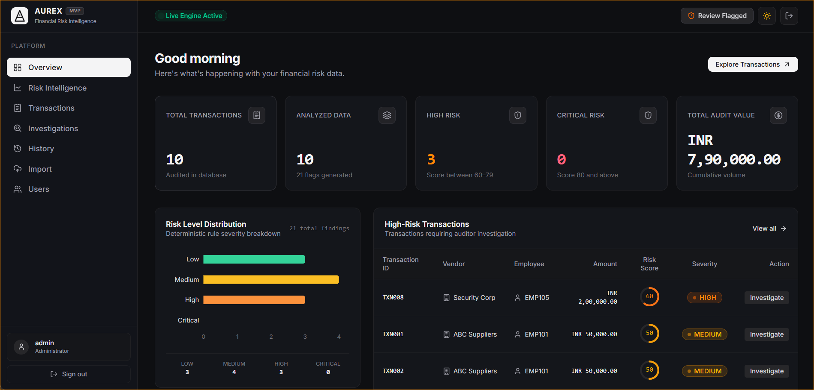
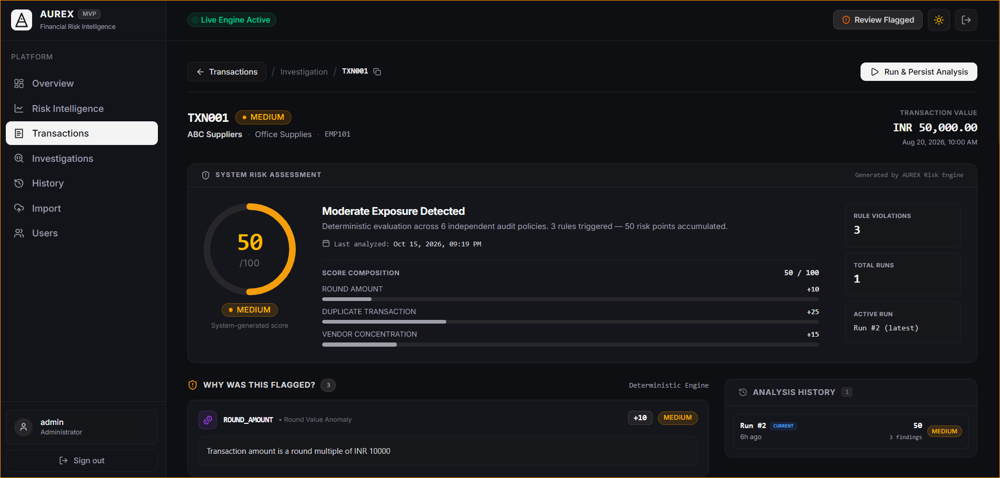
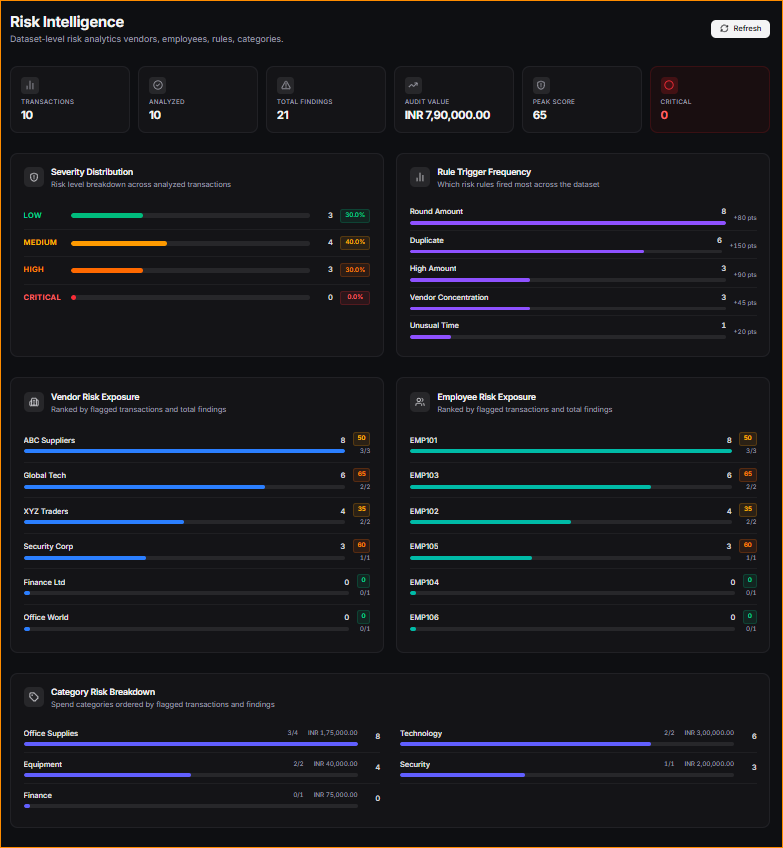

# AUREX — Financial Audit Risk Intelligence Platform

<div align="center">

[](https://github.com/vighneshtule/financial-audit-risk-platform/actions/workflows/ci.yml)
[](https://openjdk.org/projects/jdk/17/)
[](https://spring.io/projects/spring-boot)
[](https://www.postgresql.org/)
[](https://react.dev/)
[](LICENSE)

**A full-stack financial transaction risk analysis and audit platform built for deterministic, explainable risk scoring and forensic audit trail management.**

[🌐 Live Demo](#-live-demo) · [📸 Screenshots](#-application-screenshots) · [🚀 Local Setup](#-local-development-setup) · [📖 Docs](docs/)

</div>

---

## 🎯 Problem Statement

Corporate financial auditing traditionally relies on manual sample checking or disconnected spreadsheets, leading to undetected policy breaches, duplicate vendor payments, off-hours transaction anomalies, and unmonitored employee spending concentration.

AUREX solves this by ingesting transaction datasets and evaluating every record deterministically against six independent audit policies, producing explainable risk scores (0–100), severity tiers, and a persistent forensic audit trail — with role-based access control enforced at both the API and UI layers.

---

## 🌐 Live Demo


https://github.com/user-attachments/assets/ca98244e-9eb3-455d-b4ef-f48e300c62f6


> ⚠️ **Free-tier deployment notice:** AUREX is hosted on Render's free tier. The backend service may take **30–60 seconds to cold-start** after a period of inactivity. Please wait for the health check to return `{"status":"UP","database":"UP"}` before logging in.

| Resource | URL |
| :--- | :--- |
| 🖥️ **Live Application** | [https://financial-audit-risk-platform.onrender.com/](https://financial-audit-risk-platform.onrender.com/) |
| 🔑 **Login Page** | [https://financial-audit-risk-platform.onrender.com/login](https://financial-audit-risk-platform.onrender.com/login) |
| 💓 **Backend Health Check** *(technical)* | [https://aurex-backend-lbho.onrender.com/api/health](https://aurex-backend-lbho.onrender.com/api/health) |
| 📦 **GitHub Repository** | [https://github.com/vighneshtule/financial-audit-risk-platform](https://github.com/vighneshtule/financial-audit-risk-platform) |

> **Note:** Swagger UI is disabled on the production deployment by default (`ENABLE_SWAGGER=false`). API documentation is available locally at `http://localhost:8080/swagger-ui.html` when running the dev profile.

---

## 📸 Application Screenshots

> All screenshots show sample/demo data loaded for demonstration purposes.

### Overview Dashboard
The main dashboard provides an at-a-glance executive summary: total transactions audited, risk-level distribution (LOW / MEDIUM / HIGH / CRITICAL), high-risk transaction queue, and cumulative audit value.



---

### Transaction Investigation Workspace
Drill into any individual transaction for a full forensic breakdown: deterministic risk score gauge (0–100), score composition showing which rules fired and by how many points, finding explanations, and analysis run history.



---

### Risk Intelligence Analytics
Dataset-level multi-dimensional analytics: severity distribution, rule trigger frequency across the entire dataset, vendor risk exposure ranking, employee risk exposure ranking, and category risk breakdown.



---

## ✨ Key Features

| Feature | Description |
| :--- | :--- |
| **CSV Transaction Ingestion** | RFC 4180-compliant batch import up to 50 MB; atomic JDBC insertion with full rollback on error |
| **Deterministic Risk Engine** | Six independent, configurable audit policies; scores 0–100 capped; fully reproducible results |
| **Explainable Findings** | Every finding stores rule name, points added, severity, and a human-readable explanation |
| **Transaction Investigation** | Per-transaction forensic workspace with score composition, meta-profile, and run history |
| **Evidence Context Graph** | Related vendor, employee, and category cross-entity relationship queries with aggregate metrics |
| **Audit Decision Recording** | Formal auditor verdicts (`CONFIRMED_RISK`, `FALSE_POSITIVE`, `REQUIRES_INVESTIGATION`, `ESCALATED`) with append-only event log |
| **Risk Intelligence Analytics** | Executive-level multi-dimensional analytics: severity, rule frequency, vendor/employee/category exposure |
| **Role-Based Access Control** | Three enforced roles — `ADMIN`, `AUDITOR`, `VIEWER` — via Spring Security 6 + JJWT |
| **Audit Run History** | Full persistence of historical evaluation runs per transaction to track risk evolution |
| **Self-Lockout Prevention** | Admins cannot disable their own account or the last active admin; pessimistic row locking used |

---

## 🔐 Risk Scoring Rules

| Rule | Trigger Condition | Score Added | Severity |
| :--- | :--- | :---: | :---: |
| **High Amount** | `amount > INR 100,000` | +30 | MEDIUM |
| **Unusual Time** | Transaction outside 09:00–18:00 | +20 | MEDIUM |
| **Round Amount** | `amount > 0` and `amount % 10,000 == 0` | +10 | MEDIUM |
| **Transaction Velocity** | ≥ 3 transactions by same employee in any 30-min window | +20 | MEDIUM |
| **Duplicate Transaction** | Same vendor + employee + amount + category within 10 min | +25 | MEDIUM |
| **Vendor Concentration** | ≥ 3 transactions with single vendor comprising ≥ 70% of employee's spend | +15 | MEDIUM |

**Composite Score** = `min(sum of triggered rule scores, 100)`

**Severity Tiers**: LOW (0–29) · MEDIUM (30–59) · HIGH (60–79) · CRITICAL (80–100)

---

## 🔑 Security & Role-Based Access

AUREX enforces strict RBAC at the API layer via Spring Security 6 and stateless HMAC-SHA256 JWTs:

| Role | Capabilities |
| :--- | :--- |
| **ADMIN** | Full access: user lifecycle management, CSV import, risk analysis, audit decisions |
| **AUDITOR** | CSV import, risk analysis, transaction investigation, audit decision recording |
| **VIEWER** | Read-only: browse transactions, view risk scores, inspect findings and decisions |

- Per-request database status check: disabled accounts are immediately rejected on the next request, even with a valid JWT.
- BCrypt (strength 10) salted password hashing — no plaintext passwords stored.
- Auditor identity on every decision is sourced strictly from the authenticated principal, not from the request body.

---

## 🏗️ Architecture Overview

```text
  React 19 + TypeScript SPA (Vite, Tailwind CSS, Recharts, Framer Motion)
                            │
                            ▼ HTTP/REST (Axios, proxied via Nginx /api/)
             Spring Boot 3.5.6 Web Application
             ├── Spring Security 6 (JWT Filter, RBAC)
             ├── REST Controllers (Auth, Transactions, Risk, Audit, Dashboard)
             ├── Service Layer (Import Facade, Risk Engine, Audit Service)
             ├── Deterministic Rule Engine (6 independent RiskRule implementations)
             └── Plain JDBC Repositories (JdbcTemplate — zero JPA/Hibernate)
                            │
                            ▼ JDBC Connection Pool
              PostgreSQL 16 (Idempotent schema.sql, B-Tree indexes)
```

**Docker Compose Topology:**
- `aurex-frontend` (Nginx) — only container with a host-published port (`${FRONTEND_PORT:-80}`)
- `aurex-backend` (Spring Boot on Temurin 17 JRE Alpine) — internal `aurex-network` only, not published to host
- `aurex-postgres` (PostgreSQL 16 Alpine) — internal `aurex-network` only, named volume for persistence

---

## 🛠️ Technology Stack

| Layer | Technology | Version |
| :--- | :--- | :--- |
| **Backend Runtime** | Java (OpenJDK) | 17 LTS |
| **Backend Framework** | Spring Boot | 3.5.6 |
| **Security & Auth** | Spring Security 6 + JJWT | 0.12.6 |
| **Persistence** | Plain JDBC (`JdbcTemplate`, `DataSourceUtils`) | — no JPA/Hibernate |
| **Database** | PostgreSQL | 16 |
| **API Docs** | Springdoc OpenAPI / Swagger UI | 2.8.5 |
| **Frontend Framework** | React + TypeScript | 19 / 6 |
| **Build Tool** | Vite | 8.3 |
| **Frontend Styling** | Tailwind CSS (Vite plugin) | 4.3 |
| **Charts** | Recharts | 3.10 |
| **Animations** | Framer Motion | 13.4 |
| **Testing (Backend)** | JUnit 5 + Testcontainers + MockMvc | JUnit 5.12.2 / TC 1.21.4 |
| **Testing (Frontend)** | Node.js built-in test runner | v24 |
| **Containerisation** | Docker + Docker Compose | — |
| **CI** | GitHub Actions | — |

---

## 🚀 Local Development Setup

### Prerequisites

- JDK 17+
- Node.js 20+ & npm
- PostgreSQL 16 (or Docker Desktop)
- Maven 3.9+

### 1. Database Setup

Ensure PostgreSQL is running on port 5432 and create the target database:

```sql
CREATE DATABASE financial_audit;
```

The schema (`src/main/resources/schema.sql`) is initialised automatically on first start.

### 2. Backend Configuration & Startup

```bash
# Copy the environment template
cp .env.example .env
# Edit .env with your DB_PASSWORD, JWT_SECRET, etc.

# Run backend with Maven
mvn spring-boot:run
```

The backend API is available at `http://localhost:8080`.

Swagger UI (dev profile): `http://localhost:8080/swagger-ui.html`

### 3. Frontend Setup & Startup

```bash
cd frontend
npm install
npm run dev
```

The frontend starts at `http://localhost:5173`.

---

## 🐳 Docker Deployment

Launches the full stack — React/Nginx frontend, Spring Boot backend, and PostgreSQL — in three containers:

### 1. Configure Environment

```bash
cp .env.example .env
```

Generate a secure `JWT_SECRET` (minimum 32 characters) and a strong `DB_PASSWORD`:

```bash
# Linux / macOS / Git Bash:
openssl rand -base64 64
```

### 2. First-Run Admin Provisioning *(optional)*

For a fresh production database, set `AUREX_PROD_INITIAL_ADMIN_PASSWORD` (min 12 characters) in `.env`.
The application creates an initial `admin` account on first boot. Remove this variable once logged in.

### 3. Start the Stack

```bash
docker compose up -d --build
```

| Service | URL |
| :--- | :--- |
| **Frontend UI** | `http://localhost` (or `http://localhost:${FRONTEND_PORT}`) |
| **Backend API** | Proxied via Nginx at `http://localhost/api` — not directly exposed |
| **Database** | Internal Docker network only — port 5432 not published to host |

### 4. Verify Health

```bash
curl http://localhost/api/health
# Expected: {"status":"UP","database":"UP"}
```

### 5. Stop the Stack

```bash
docker compose down
# WARNING: Do NOT use -v unless you intend to destroy database volumes.
```

---

## 🧪 Running Tests

### Backend (Unit + Integration with Testcontainers)

```bash
mvn clean test
```

Runs 175 tests across 18 test classes, including full Spring Boot context integration tests against an ephemeral PostgreSQL 16 Testcontainers instance. All 175 tests pass with 0 failures.

### Frontend (Type-check + Unit Tests)

```bash
cd frontend
npm test          # 56 tests across 13 suites via Node.js test runner
npm run build     # TypeScript compile + Vite production build
```

---

## 🔑 Environment Variables Reference

| Variable | Default | Description |
| :--- | :--- | :--- |
| `FRONTEND_PORT` | `80` | Host port mapped to the Nginx frontend container |
| `PORT` | `8080` | Spring Boot internal HTTP port (not published to host in Compose) |
| `POSTGRES_DB` | `financial_audit` | PostgreSQL database name |
| `DB_USERNAME` | `postgres` | Database username |
| `DB_PASSWORD` | *(required)* | Database password — set a strong value |
| `JWT_SECRET` | *(required, min 32 chars)* | HMAC-SHA256 signing secret for JWT tokens |
| `JWT_EXPIRATION` | `86400` | JWT validity in seconds (default: 24 hours) |
| `AUREX_PROD_INITIAL_ADMIN_PASSWORD` | *(none)* | First-run admin account password (min 12 chars; remove after first login) |
| `AUREX_PROD_INITIAL_ADMIN_USERNAME` | `admin` | First-run admin username |
| `AUREX_SEED_ADMIN_ENABLED` | `false` | Enable dev admin seeding (dev profile only — blocked in prod) |
| `AUREX_DEV_ADMIN_PASSWORD` | *(none)* | Required when `AUREX_SEED_ADMIN_ENABLED=true` in dev profile |
| `CORS_ALLOWED_ORIGINS` | `http://localhost,http://localhost:80` | Comma-separated allowed CORS origins |
| `SPRING_PROFILES_ACTIVE` | `prod` *(in Compose)* | Active Spring profile (`dev` or `prod`) |
| `ENABLE_SWAGGER` | `false` *(in prod)* | Set `true` to enable Swagger UI in staging/prod |
| `VITE_API_BASE_URL` | `/api` | Base API URL baked into the frontend build |

---

## 📡 API Overview

All endpoints require `Authorization: Bearer <token>` except `/api/auth/login` and `/api/health`.

| Method | Endpoint | Auth Required | Min Role | Description |
| :--- | :--- | :---: | :--- | :--- |
| `POST` | `/api/auth/login` | No | — | Authenticate and receive JWT |
| `GET` | `/api/auth/me` | Yes | VIEWER | Current user session details |
| `GET` | `/api/health` | No | — | System and database health check |
| `GET` | `/api/transactions` | Yes | VIEWER | Paginated transaction list |
| `POST` | `/api/transactions/import` | Yes | AUDITOR | Upload & import CSV transaction batch |
| `GET` | `/api/risk/summary` | Yes | VIEWER | Executive risk overview metrics |
| `GET` | `/api/risk/transactions` | Yes | VIEWER | Paginated risk list with level/score filters |
| `GET` | `/api/risk/transactions/{id}` | Yes | VIEWER | Live risk report for a specific transaction |
| `POST` | `/api/risk/analyze/{id}` | Yes | AUDITOR | Evaluate & persist a risk run |
| `POST` | `/api/risk/analyze-all` | Yes | AUDITOR | Batch evaluate & persist across dataset |
| `GET` | `/api/risk/transactions/{id}/context` | Yes | VIEWER | Cross-entity evidence context graph |
| `GET` | `/api/risk/transactions/{id}/history` | Yes | VIEWER | Historical analysis runs for a transaction |
| `POST` | `/api/risk/transactions/{id}/audit/decisions` | Yes | AUDITOR | Record formal audit decision |
| `GET` | `/api/risk/transactions/{id}/audit/decisions` | Yes | VIEWER | Retrieve audit decisions for transaction |
| `GET` | `/api/risk/transactions/{id}/audit/events` | Yes | VIEWER | Retrieve append-only audit event log |
| `GET` | `/api/risk/intelligence/summary` | Yes | VIEWER | Multi-dimension risk analytics |
| `GET` | `/api/users` | Yes | ADMIN | List all user accounts |
| `POST` | `/api/users` | Yes | ADMIN | Create a new user account |
| `PATCH` | `/api/users/{id}/status` | Yes | ADMIN | Enable/disable user account |

> Full request/response schemas are documented in [`docs/project-submission/API_DOCUMENTATION.md`](docs/project-submission/API_DOCUMENTATION.md).

---

## 📂 Project Structure

```text
financial-audit-risk-platform/
├── .github/workflows/ci.yml          # GitHub Actions CI Pipeline
├── Dockerfile                        # Multi-stage backend Dockerfile (Maven → Temurin JRE Alpine)
├── docker-compose.yml                # Three-container orchestration (frontend, backend, postgres)
├── .env.example                      # Environment configuration template
├── pom.xml                           # Maven project descriptor
├── data/
│   └── imgs/                         # Application screenshots
├── docs/
│   ├── ARCHITECTURE.md               # Architecture overview
│   ├── DEPLOYMENT.md                 # Deployment guide
│   └── project-submission/           # Full academic documentation pack (BCA field project)
│       ├── DOCUMENTATION_INDEX.md    # Master index of all documentation
│       ├── ER_DIAGRAM.md             # Entity-relationship documentation
│       ├── DATA_DICTIONARY.md        # Database data dictionary
│       ├── SYSTEM_ARCHITECTURE.md    # Detailed architecture document
│       ├── API_DOCUMENTATION.md      # Full REST API reference
│       └── ...                       # (16 documents + 14 diagram sources)
├── src/main/java/
│   ├── com/vighnesh/
│   │   ├── config/                   # Web, CORS & OpenAPI configuration
│   │   ├── controller/               # REST API controllers
│   │   ├── exception/                # Global exception handler
│   │   └── service/                  # Business services & facades
│   ├── config/                       # Core JDBC database config
│   ├── model/                        # Domain & DTO models
│   ├── repository/                   # Plain JDBC repositories (no JPA)
│   └── rule/                         # Deterministic risk policy implementations
└── frontend/
    ├── src/
    │   ├── api/                      # Centralized Axios client & API functions
    │   ├── components/               # Reusable UI components & gauges
    │   ├── pages/                    # Application page views (9 pages)
    │   └── types/                    # TypeScript type definitions
    └── vite.config.ts                # Vite build & proxy configuration
```

---

## ⚠️ Known Limitations

- **Free-tier cold starts:** The Render backend service sleeps after inactivity. Expect a 30–60 second startup delay on the first request.
- **No persistent database on free tier:** Render's free PostgreSQL instance may be reset periodically. Data is not guaranteed to persist indefinitely on the live demo.
- **No cryptographic audit immutability:** The `audit_events` table is append-only at the application layer (no UPDATE/DELETE APIs). It does not use database-level WORM constraints or cryptographic signing.
- **No formal throughput benchmarks:** The risk engine is deterministic and indexed for performance, but no formal JMH or load benchmarks have been executed.
- **Swagger disabled in production:** API documentation requires the `ENABLE_SWAGGER=true` environment variable or running locally in dev mode.

---

## 🛣️ Future Roadmap

> Items listed here are aspirational plans — none are currently implemented in the codebase.

- [ ] **AI-Assisted Investigation Narratives:** LLM layer generating natural language audit summaries from deterministic evidence graph data.
- [ ] **Case Management Workflow:** Flagged transaction lifecycle (`OPEN`, `IN_REVIEW`, `RESOLVED`, `ESCALATED`) beyond the current decision status values.
- [ ] **Multi-currency Support:** Foreign exchange conversion for cross-currency transaction analysis.
- [ ] **Live Streaming Ingestion:** Apache Kafka or RabbitMQ integration for real-time transaction feeds.
- [ ] **Two-Factor Authentication:** TOTP or SMS-based 2FA for compliance administrator accounts.

---

## 📚 Documentation

The `docs/project-submission/` directory contains a full academic documentation pack:

| Document | Description |
| :--- | :--- |
| [`DOCUMENTATION_INDEX.md`](docs/project-submission/DOCUMENTATION_INDEX.md) | Master navigation index |
| [`SYSTEM_ARCHITECTURE.md`](docs/project-submission/SYSTEM_ARCHITECTURE.md) | Full architecture document |
| [`ER_DIAGRAM.md`](docs/project-submission/ER_DIAGRAM.md) | Entity-relationship documentation |
| [`DATA_DICTIONARY.md`](docs/project-submission/DATA_DICTIONARY.md) | Database data dictionary |
| [`API_DOCUMENTATION.md`](docs/project-submission/API_DOCUMENTATION.md) | Complete REST API reference |
| [`TEST_PLAN_AND_RESULTS.md`](docs/project-submission/TEST_PLAN_AND_RESULTS.md) | Test plan & verified results |
| [`REQUIREMENTS_TRACEABILITY.md`](docs/project-submission/REQUIREMENTS_TRACEABILITY.md) | Requirements traceability matrix |
| [`FINAL_DOCUMENTATION_REVIEW.md`](docs/project-submission/FINAL_DOCUMENTATION_REVIEW.md) | Pre-submission accuracy review |

---

*AUREX — BCA Field Project, MIT Arts, Commerce & Science College, Alandi · Built with Spring Boot, React, and PostgreSQL.*
