# AUREX — UML Class Diagram Specification

**Document Version:** 1.0  
**Project Name:** AUREX — Financial Audit Risk Platform  
**Academic Context:** BCA Field Project, MIT Arts, Commerce & Science College, Alandi  
**Diagram Source:** [`diagrams/class-diagram.puml`](diagrams/class-diagram.puml)  

---

## 1. Class Architecture & Design Patterns

The backend object model of AUREX is designed using clean architectural layering, strict separation of concerns, and classic object-oriented design patterns:
1. **Strategy Pattern (`rule` package)**: The deterministic risk engine defines `RiskRule` and `DatasetRiskRule` interfaces. Individual policies (`HighAmountRule`, `TransactionVelocityRule`, etc.) encapsulate discrete evaluation algorithms, allowing policies to be added or modified independently without changing the engine.
2. **Factory Pattern (`RiskEngineFactory`)**: Decouples the creation and configuration of the `RiskEngine` instance from its execution, injecting active thresholds from `RiskConfiguration`.
3. **Facade Pattern (`TransactionImportFacade`)**: Provides a Spring-managed service abstraction over the lower-level `TransactionImportService` and `TransactionCsvReader`.
4. **Data Access Object (DAO / Repository Pattern)**: Repositories encapsulate all raw SQL operations using plain JDBC (`PreparedStatement`, `JdbcTemplate`, `DataSourceUtils`), completely eliminating ORM impedance mismatch.
5. **Data Transfer Object (DTO) Pattern**: Request and response objects (`LoginRequest`, `CreateAuditDecisionRequest`, `UserDto`, etc.) prevent domain entity exposure and sanitize sensitive fields (such as password hashes).

---

## 2. PlantUML Class Diagram Representation

```plantuml
@startuml
skinparam classAttributeIconSize 0
skinparam monochrome false
skinparam roundcorner 8
skinparam shadowing false
skinparam packageStyle rectangle

package "rule" {
    interface RiskRule {
        +evaluate(transaction: Transaction): RiskFinding
    }

    interface DatasetRiskRule {
        +evaluate(transaction: Transaction, transactions: List<Transaction>): RiskFinding
    }

    class HighAmountRule implements RiskRule {
        -threshold: BigDecimal
        -score: int
        +evaluate(transaction: Transaction): RiskFinding
    }

    class UnusualTimeRule implements RiskRule {
        -businessStart: LocalTime
        -businessEnd: LocalTime
        -score: int
        +evaluate(transaction: Transaction): RiskFinding
    }

    class RoundAmountRule implements RiskRule {
        -unit: BigDecimal
        -score: int
        +evaluate(transaction: Transaction): RiskFinding
    }

    class TransactionVelocityRule implements DatasetRiskRule {
        -windowMinutes: long
        -threshold: int
        -score: int
        +evaluate(transaction: Transaction, transactions: List<Transaction>): RiskFinding
    }

    class DuplicateTransactionRule implements DatasetRiskRule {
        -duplicateWindowMinutes: long
        -score: int
        -cache: Map
        +evaluate(transaction: Transaction, transactions: List<Transaction>): RiskFinding
    }

    class VendorConcentrationRule implements DatasetRiskRule {
        -thresholdPercent: double
        -minimumTransactions: int
        -score: int
        +evaluate(transaction: Transaction, transactions: List<Transaction>): RiskFinding
    }

    class DuplicateTransactionIndex {
        -groups: Map<TransactionKey, List<Transaction>>
        +{static} from(transactions: List<Transaction>): DuplicateTransactionIndex
        +getPossibleDuplicates(transaction: Transaction): List<Transaction>
    }
    DuplicateTransactionRule ..> DuplicateTransactionIndex : uses
}

package "com.vighnesh.service & service" {
    class RiskEngine {
        -scoreCalculator: RiskScoreCalculator
        -rules: List<RiskRule>
        -datasetRules: List<DatasetRiskRule>
        +addRule(rule: RiskRule): void
        +addDatasetRule(rule: DatasetRiskRule): void
        +analyze(transaction: Transaction, transactions: List<Transaction>): RiskReport
    }

    class RiskEngineFactory {
        -riskConfiguration: RiskConfiguration
        +create(): RiskEngine
    }

    class RiskScoreCalculator {
        +calculateScore(findings: List<RiskFinding>): int
        +determineSeverity(score: int): RiskSeverity
    }

    class RiskAnalysisService {
        -transactionRepository: TransactionRepository
        -riskAnalysisRunRepository: RiskAnalysisRunRepository
        -riskFindingRepository: RiskFindingRepository
        -riskEngineFactory: RiskEngineFactory
        +analyzeTransaction(id: String): RiskReport
        +analyzeSummary(): RiskSummary
        +analyzeTransactions(riskLevel: RiskSeverity, minScore: Integer, page: int, size: int): RiskTransactionPage
        +analyzeAndPersistTransaction(id: String): RiskReport
        +analyzeAndPersistAllTransactions(): AnalysisResult
        +getTransactionRiskHistory(id: String): RiskAnalysisHistoryResponse
    }

    class AuditService {
        -transactionRepository: TransactionRepository
        -riskAnalysisRunRepository: RiskAnalysisRunRepository
        -auditDecisionRepository: AuditDecisionRepository
        -auditEventRepository: AuditEventRepository
        +recordDecision(transactionId: String, request: CreateAuditDecisionRequest, actor: String): AuditDecision
        +getLatestDecision(transactionId: String): AuditDecision
        +getDecisionHistory(transactionId: String): List<AuditDecision>
        +getAuditEventHistory(transactionId: String): List<AuditEvent>
    }

    class AnalyticsService {
        -analyticsRepository: AnalyticsRepository
        +getRiskIntelligenceSummary(): RiskIntelligenceSummary
    }

    class TransactionImportFacade {
        -delegate: TransactionImportService
        +importFromCsv(filePath: String): int
    }

    class TransactionImportService {
        -csvReader: TransactionCsvReader
        -transactionRepository: TransactionRepository
        -dataSource: DataSource
        +importFromCsv(filePath: String): int
    }

    class TransactionCsvReader {
        +read(filePath: String): List<Transaction>
    }

    RiskEngine --> RiskScoreCalculator
    RiskEngine *-- RiskRule
    RiskEngine *-- DatasetRiskRule
    RiskEngineFactory ..> RiskEngine : creates
    RiskAnalysisService --> RiskEngineFactory
    TransactionImportFacade --> TransactionImportService
    TransactionImportService --> TransactionCsvReader
}

package "repository" {
    class TransactionRepository {
        -dataSource: DataSource
        +save(connection: Connection, transaction: Transaction): void
        +findById(id: String): Transaction
        +findAll(): List<Transaction>
    }

    class RiskAnalysisRunRepository {
        -dataSource: DataSource
        +save(transactionId: String, score: int, level: RiskSeverity): long
        +findLatestByTransactionId(id: String): RiskAnalysisRun
        +findByTransactionId(id: String): List<RiskAnalysisRun>
        +countByTransactionId(id: String): int
    }

    class RiskFindingRepository {
        -dataSource: DataSource
        +save(runId: long, transactionId: String, finding: RiskFinding): void
        +findByAnalysisRunId(runId: long): List<RiskFinding>
        +findByAnalysisRunIds(runIds: List<Long>): Map<Long, List<RiskFinding>>
    }

    class AuditDecisionRepository {
        -dataSource: DataSource
        +save(transactionId: String, runId: long, decision: AuditDecisionType, comment: String, actor: String): long
        +findLatestByTransactionId(id: String): AuditDecision
        +findByTransactionId(id: String): List<AuditDecision>
    }

    class AuditEventRepository {
        -dataSource: DataSource
        +save(transactionId: String, decisionId: Long, eventType: String, details: String, actor: String): long
        +findByTransactionId(id: String): List<AuditEvent>
    }

    class AnalyticsRepository {
        -dataSource: DataSource
        +getDatasetOverview(): DatasetOverview
        +getSeverityDistribution(): List<SeverityCount>
        +getVendorRisk(): List<VendorRisk>
        +getEmployeeRisk(): List<EmployeeRisk>
        +getCategoryRisk(): List<CategoryRisk>
        +getRiskTypeDistribution(): List<RiskTypeDistribution>
    }
}

package "com.vighnesh.user & auth" {
    class UserService {
        -userRepository: UserRepository
        -passwordEncoder: PasswordEncoder
        +createUser(request: CreateUserRequest): UserDto
        +updateUserStatus(id: Long, enabled: boolean, adminUsername: String): UserDto
        +getAllUsers(): List<UserDto>
        +findByUsername(username: String): User
    }

    class UserRepository {
        -jdbcTemplate: JdbcTemplate
        +findByUsername(username: String): Optional<User>
        +findById(id: Long): Optional<User>
        +save(user: User): User
        +findAll(): List<User>
        +findAdminsForUpdate(): List<User>
        +updateStatus(id: Long, enabled: boolean): void
    }

    class AuthService {
        -userRepository: UserRepository
        -passwordEncoder: PasswordEncoder
        -jwtService: JwtService
        +login(request: LoginRequest): LoginResponse
        +getCurrentUser(username: String): UserDto
    }

    class JwtService {
        -jwtSecret: String
        -jwtExpirationInSeconds: long
        +generateToken(username: String, userId: Long, role: UserRole): String
        +validateToken(token: String): boolean
        +getUsernameFromToken(token: String): String
        +getRoleFromToken(token: String): UserRole
    }

    UserService --> UserRepository
    AuthService --> UserRepository
    AuthService --> JwtService
}

package "controller" {
    class AuthController {
        -authService: AuthService
        +login(request: LoginRequest): ResponseEntity<LoginResponse>
        +me(): ResponseEntity<UserDto>
    }

    class UserController {
        -userService: UserService
        +getAllUsers(): ResponseEntity<List<UserDto>>
        +createUser(request: CreateUserRequest): ResponseEntity<UserDto>
        +updateUserStatus(id: Long, request: UpdateUserStatusRequest, principal: Principal): ResponseEntity<UserDto>
    }

    class RiskController {
        -riskAnalysisService: RiskAnalysisService
        -riskEvidenceService: RiskEvidenceService
        +analyzeTransaction(id: String): ResponseEntity<RiskReport>
        +analyzeAndPersistTransaction(id: String): ResponseEntity<RiskReport>
        +analyzeAll(): ResponseEntity<AnalysisResult>
        +getRiskTransactions(level: RiskSeverity, minScore: Integer, page: int, size: int): ResponseEntity<RiskTransactionPage>
    }

    class AuditController {
        -auditService: AuditService
        +createDecision(id: String, request: CreateAuditDecisionRequest, principal: Principal): ResponseEntity<AuditDecision>
        +getDecisions(id: String): ResponseEntity<List<AuditDecision>>
        +getLatestDecision(id: String): ResponseEntity<AuditDecision>
    }

    class TransactionImportController {
        -importFacade: TransactionImportFacade
        +importCsv(file: MultipartFile): ResponseEntity<ImportResponse>
    }

    AuthController --> AuthService
    UserController --> UserService
    RiskController --> RiskAnalysisService
    AuditController --> AuditService
    TransactionImportController --> TransactionImportFacade
}
@enduml
```

---

## 3. Package & Responsibility Inventory

### 3.1 Package: `rule`
Contains the core deterministic risk evaluation abstractions and implementations:
- **`RiskRule`**: Interface defining single-transaction evaluation: `RiskFinding evaluate(Transaction transaction)`. Implemented by `HighAmountRule`, `UnusualTimeRule`, `RoundAmountRule`.
- **`DatasetRiskRule`**: Interface defining cross-dataset evaluation: `RiskFinding evaluate(Transaction transaction, List<Transaction> transactions)`. Implemented by `TransactionVelocityRule`, `DuplicateTransactionRule`, `VendorConcentrationRule`.
- **`DuplicateTransactionIndex`**: In-memory hash index grouping transactions by composite key `(vendor, employee, amount, category)` to accelerate $O(1)$ duplicate lookups.

### 3.2 Package: `service` / `com.vighnesh.service`
Orchestrates business operations, database transactions, and component interactions:
- **`RiskEngine`**: Aggregates registered rules and executes evaluation against a transaction, passing findings to `RiskScoreCalculator`.
- **`RiskEngineFactory`**: Spring `@Component` that constructs fresh `RiskEngine` instances wired with active configuration properties.
- **`RiskScoreCalculator`**: Sums finding scores, applies the 100-point ceiling, and categorizes severity tiers (`LOW`, `MEDIUM`, `HIGH`, `CRITICAL`).
- **`RiskAnalysisService`**: Primary transactional orchestrator for single-transaction analysis, batch analysis, history run retrieval, and finding persistence.
- **`AuditService`**: Enforces business validation on audit decision recording, sources the actor from the authenticated `Principal`, and manages dual-table transactional logging.
- **`TransactionImportFacade` & `TransactionImportService`**: Manages file parsing and atomic plain JDBC batch insertion with rollback safety.
- **`AnalyticsService` & `RiskEvidenceService`**: Computes multi-dimensional risk metrics and cross-entity relationship context graphs.

### 3.3 Package: `repository`
Encapsulates data persistence using plain JDBC:
- **`TransactionRepository`**: Direct SQL queries (`save`, `findById`, `findAll`) on `transactions`.
- **`RiskAnalysisRunRepository`**: Manages insert, pagination, and latest-run queries on `risk_analysis_runs`.
- **`RiskFindingRepository`**: Manages batch insertion and query retrieval of findings by analysis run IDs.
- **`AuditDecisionRepository` & `AuditEventRepository`**: Manages transactional persistence and historical queries for formal compliance records.
- **`AnalyticsRepository`**: Executes advanced PostgreSQL aggregation queries (`DISTINCT ON`, `GROUP BY`, `COALESCE`) for dashboard intelligence.

### 3.4 Package: `com.vighnesh.user` & `com.vighnesh.auth`
Manages identity, authentication, and access control:
- **`UserRepository`**: Uses Spring's `JdbcTemplate` for user lookups, inserts with `GeneratedKeyHolder`, and pessimistic row locking (`findAdminsForUpdate`).
- **`UserService`**: Implements user creation with BCrypt encoding, account status toggling, self-disable protection, and last-admin lockout safety.
- **`AuthService`**: Coordinates password verification and JWT token issuance.
- **`JwtService`**: Handles HMAC-SHA256 signature generation, validation, and claim extraction.

### 3.5 Package: `com.vighnesh.controller`
Exposes the REST API layer:
- **`AuthController`**: Handles `/api/auth/login` and `/api/auth/me`.
- **`UserController`**: Handles `/api/users` endpoints guarded by `hasRole('ADMIN')`.
- **`TransactionController` & `TransactionImportController`**: Ingestion and raw transaction browsing.
- **`RiskController` & `RiskIntelligenceController`**: Risk reporting, batch evaluation, and executive intelligence.
- **`AuditController`**: Audit decision submission and event retrieval.
- **`HealthController`**: Database and application health check.
- **`GlobalExceptionHandler`**: `@RestControllerAdvice` mapping exceptions to standard JSON error responses.
