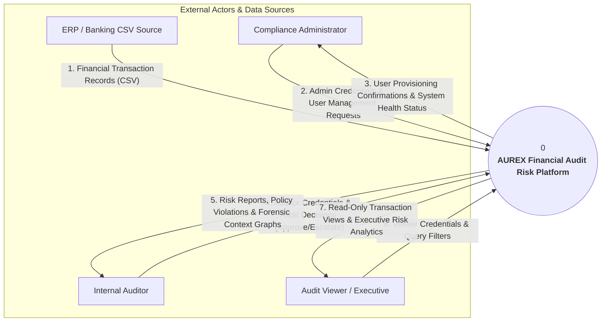
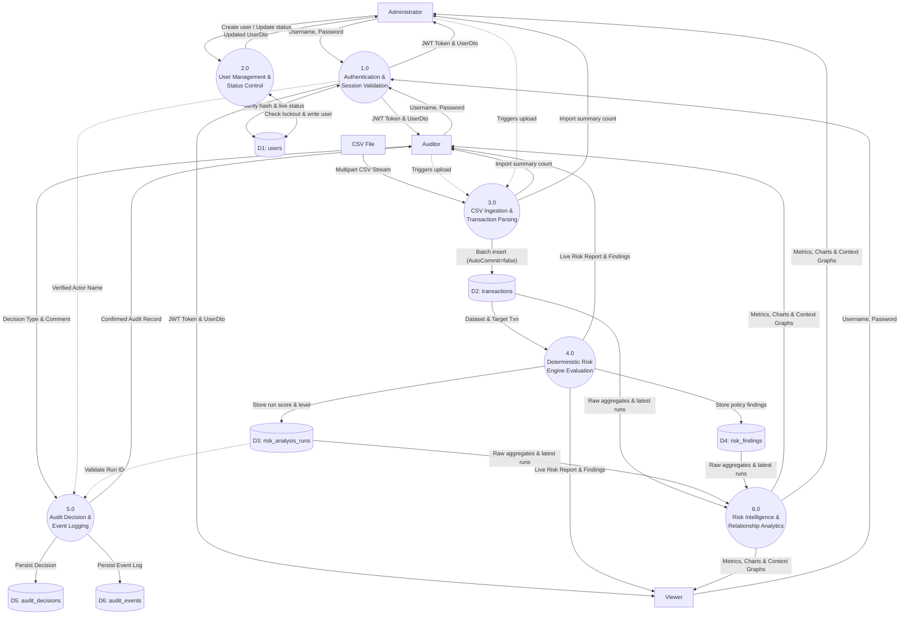

# AUREX — Data Flow Diagrams (DFD Specification)

**Document Version:** 1.0  
**Project Name:** AUREX — Financial Audit Risk Platform  
**Academic Context:** BCA Field Project, MIT Arts, Commerce & Science College, Alandi  
**Diagram Sources:** [`diagrams/dfd-context.mmd`](diagrams/dfd-context.mmd), [`diagrams/dfd-level-1.mmd`](diagrams/dfd-level-1.mmd)  

---

## 1. DFD Conventions & Methodological Overview

A Data Flow Diagram (DFD) models the flow of data through a system, identifying:
1. **External Entities (Terminators)**: External sources or consumers of data (e.g., Compliance Admin, Internal Auditor, External CSV Source).
2. **Processes**: Operations or transformations that manipulate data (numbered `0` for the system context, `1.0`, `2.0`, etc. for Level 1 decomposition).
3. **Data Stores**: Persistent data repositories based on actual PostgreSQL database tables (`D1` through `D6`).
4. **Data Flows**: Directed arrows labelled with the specific data payloads moving between entities, processes, and stores.

> **Distinction Note**: A DFD is **not** a UML sequence diagram or flow chart. It does not model temporal execution loops, sequential call stacks, or class method boundaries; it strictly models the movement and transformation of business data.

---

## 2. Level 0 Context Diagram (System Level)

The Level 0 context diagram models the entire AUREX application as a single central process interacting with external actors and external data inputs.

### Explanatory Walkthrough (Level 0)
- **ERP / Banking CSV Source**: Ingests multi-row transaction files containing accounting fields (`transaction_id`, `vendor`, `employee`, `amount`, `transaction_time`, `category`).
- **Compliance Administrator**: Supplies administrative credentials, configures system user accounts, and monitors platform health. Receives provisioning confirmations and system diagnostic metrics.
- **Internal Auditor**: Authenticates into the platform, uploads transaction batches, requests deterministic risk assessments, investigates relationship evidence graphs, and records forensic audit decisions. Receives granular policy finding reports and context data.
- **Audit Viewer / Executive**: Authenticates with read-only access to inspect risk summaries, transaction tables, and multidimensional intelligence analytics.

---

## 3. Level 1 Data Flow Diagram (Process Decomposition)

The Level 1 DFD decomposes the monolithic AUREX system into six distinct functional processes, detailing how data flows to and from the six relational database tables (`D1: users`, `D2: transactions`, `D3: risk_analysis_runs`, `D4: risk_findings`, `D5: audit_decisions`, `D6: audit_events`).

---

## 4. Process Specifications & Data Store Mapping

| Process ID | Process Name | Source Inputs | Data Stores Accessed | Output Destinations | Functional Description |
|---|---|---|---|---|---|
| **1.0** | Authentication & Session Validation | Login credentials from User (`username`, `password`) | `D1: users` (Read) | JWT token to User; Authenticated Security Context | Validates BCrypt hash; generates HMAC-SHA256 JWT; validates token and live `enabled` status on every subsequent request. |
| **2.0** | User Management & Status Control | `CreateUserRequest`, `UpdateUserStatusRequest` from Administrator | `D1: users` (Read, Write, Pessimistic Row Lock) | `UserDto` to Administrator | Inserts new users; executes self-management protection; locks admin rows via `SELECT ... FOR UPDATE` to block last-admin lockout. |
| **3.0** | CSV Ingestion & Transaction Parsing | Multipart CSV file stream from Auditor / Admin | `D2: transactions` (Batch Write) | Ingestion confirmation with record count | Validates file format; parses RFC 4180 lines; executes transactional batch inserts (`connection.setAutoCommit(false)`). |
| **4.0** | Deterministic Risk Engine Evaluation | Analysis trigger (`analyze/{id}`, `analyze-all`); transaction records | `D2: transactions` (Read), `D3: risk_analysis_runs` (Write), `D4: risk_findings` (Write) | `RiskReport` to Auditor / Viewer | Evaluates 6 audit rules; calculates capped score (0–100); classifies severity; writes run and individual finding rows. |
| **5.0** | Audit Decision & Event Logging | Audit decision type, comment, and target run ID from Auditor | `D2: transactions` (Read), `D3: risk_analysis_runs` (Read), `D5: audit_decisions` (Write), `D6: audit_events` (Write) | Confirmed `AuditDecision` to Auditor | Derives actor strictly from `Principal.getName()`; verifies transaction and run existence; writes decision and event records atomically. |
| **6.0** | Risk Intelligence & Analytics | Analytical queries from Auditor, Viewer, or Admin | `D2: transactions` (Read), `D3: risk_analysis_runs` (Read), `D4: risk_findings` (Read) | `RiskIntelligenceSummary`, `TransactionContext` | Executes analytical queries using PostgreSQL `DISTINCT ON` to aggregate metrics across vendors, employees, categories, and severity tiers. |

---

## 5. Verified Data Store Definitions

| Store ID | Table Name | Primary Purpose in Data Flow | Primary Key | Foreign Key References |
|---|---|---|---|---|
| **D1** | `users` | Stores system operator credentials, roles, and status flags. | `id` (BIGSERIAL) | None |
| **D2** | `transactions` | Stores financial records ingested from CSV batches. | `transaction_id` (VARCHAR(50)) | None |
| **D3** | `risk_analysis_runs` | Stores timestamped evaluation outcomes (score, severity level). | `id` (BIGSERIAL) | `transaction_id` $\to$ `transactions(transaction_id)` |
| **D4** | `risk_findings` | Stores granular policy violations linked to analysis runs. | `id` (BIGSERIAL) | `analysis_run_id` $\to$ `risk_analysis_runs(id)`, `transaction_id` $\to$ `transactions(transaction_id)` *(Note: foreign key is on `analysis_run_id`; there is no column named `run_id` in SQL)* |
| **D5** | `audit_decisions` | Stores formal auditor reviews and investigative classifications. | `id` (BIGSERIAL) | `transaction_id` $\to$ `transactions`, `analysis_run_id` $\to$ `risk_analysis_runs` |
| **D6** | `audit_events` | Stores append-only compliance history logs triggered by decisions. | `id` (BIGSERIAL) | `transaction_id` $\to$ `transactions`, `decision_id` $\to$ `audit_decisions` |
