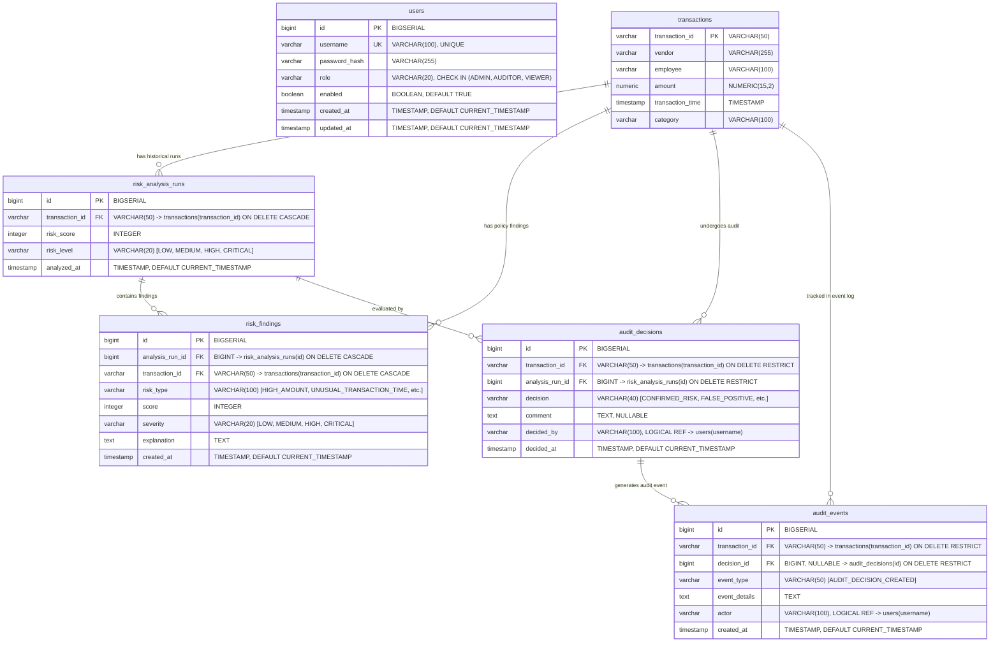

# AUREX — Entity Relationship Diagram (ERD Specification)

**Document Version:** 1.0  
**Project Name:** AUREX — Financial Audit Risk Platform  
**Academic Context:** BCA Field Project, MIT Arts, Commerce & Science College, Alandi  
**Diagram Source:** [`diagrams/er-diagram.mmd`](diagrams/er-diagram.mmd)  
**Database Engine:** PostgreSQL 16  
**Schema Definition:** [`src/main/resources/schema.sql`](../../src/main/resources/schema.sql)  

---

## 1. Relational Database Schema Overview

The database design for AUREX is optimized for high-performance financial transaction auditing, deterministic risk run tracking, and forensic compliance history logging. It enforces relational integrity through strict foreign key constraints, check constraints, cascade deletions for evaluation runs, and restrict deletions for audit decisions.

---

## 2. Table-by-Table Data Dictionary & Schema Specifications

### 2.1 Table: `users`
Stores user credentials, role assignments, and account activation flags.

| Column Name | Data Type | Nullable | Constraints & Defaults | Description & Source Evidence |
|---|---|---|---|---|
| `id` | `BIGSERIAL` | **NO** | `PRIMARY KEY` | Auto-incrementing 64-bit unique user identifier. |
| `username` | `VARCHAR(100)` | **NO** | `UNIQUE` | Case-sensitive unique account username. |
| `password_hash`| `VARCHAR(255)` | **NO** | None | BCrypt salted hash of the user password. Plaintext is never stored. |
| `role` | `VARCHAR(20)` | **NO** | `CHECK (role IN ('ADMIN', 'AUDITOR', 'VIEWER'))` | Assigned security role controlling endpoint permissions. |
| `enabled` | `BOOLEAN` | **NO** | `DEFAULT TRUE` | Account active flag. If `false`, token validation immediately rejects requests. |
| `created_at` | `TIMESTAMP` | **NO** | `DEFAULT CURRENT_TIMESTAMP` | System timestamp of user account provisioning. |
| `updated_at` | `TIMESTAMP` | **NO** | `DEFAULT CURRENT_TIMESTAMP` | System timestamp of last profile or status update. |

**Indexes on `users`:**
- `PRIMARY KEY` on `(id)`
- `idx_users_username` (`UNIQUE`, B-Tree on `username`)
- `idx_users_role` (B-Tree on `role`)

---

### 2.2 Table: `transactions`
Stores corporate financial transactions ingested from CSV batches.

| Column Name | Data Type | Nullable | Constraints & Defaults | Description & Source Evidence |
|---|---|---|---|---|
| `transaction_id`| `VARCHAR(50)` | **NO** | `PRIMARY KEY` | External unique transaction reference identifier from source accounting records. |
| `vendor` | `VARCHAR(255)` | **NO** | None | Name of the payee or vendor receiving funds. |
| `employee` | `VARCHAR(100)` | **NO** | None | Corporate employee or department initiating the transaction. |
| `amount` | `NUMERIC(15,2)`| **NO** | None | Monetary amount in INR with fixed two decimal point precision. |
| `transaction_time`| `TIMESTAMP` | **NO** | None | Actual timestamp when the financial transaction occurred. |
| `category` | `VARCHAR(100)` | **NO** | None | Expense category (e.g. `SOFTWARE`, `HARDWARE`, `LOGISTICS`, `TRAVEL`). |

**Indexes on `transactions`:**
- `PRIMARY KEY` on `(transaction_id)`
- `idx_transactions_vendor` (B-Tree on `vendor`) — optimizes vendor peer relationship queries.
- `idx_transactions_employee` (B-Tree on `employee`) — optimizes velocity and concentration calculations.
- `idx_transactions_category` (B-Tree on `category`) — optimizes category risk distribution queries.
- `idx_transactions_time` (B-Tree on `transaction_time`) — optimizes chronological sorting and velocity queries.

---

### 2.3 Table: `risk_analysis_runs`
Stores historical evaluations generated by the deterministic risk engine.

| Column Name | Data Type | Nullable | Constraints & Defaults | Description & Source Evidence |
|---|---|---|---|---|
| `id` | `BIGSERIAL` | **NO** | `PRIMARY KEY` | Auto-incrementing unique identifier for each evaluation run. |
| `transaction_id`| `VARCHAR(50)` | **NO** | `FK -> transactions(transaction_id) ON DELETE CASCADE` | Reference to the evaluated transaction. |
| `risk_score` | `INTEGER` | **NO** | None | Aggregated risk score (0 to 100). |
| `risk_level` | `VARCHAR(20)` | **NO** | None | Derived severity tier (`LOW`, `MEDIUM`, `HIGH`, `CRITICAL`). |
| `analyzed_at` | `TIMESTAMP` | **NO** | `DEFAULT CURRENT_TIMESTAMP` | Timestamp when the risk evaluation was performed. |

**Indexes on `risk_analysis_runs`:**
- `PRIMARY KEY` on `(id)`
- `idx_analysis_runs_transaction` (B-Tree on `transaction_id`)
- `idx_analysis_runs_analyzed_at` (B-Tree on `analyzed_at`)
- `idx_analysis_runs_txn_analyzed` (Composite B-Tree on `(transaction_id, analyzed_at DESC, id DESC)`) — optimizes PostgreSQL `DISTINCT ON (transaction_id)` queries fetching the latest analysis run per transaction.

---

### 2.4 Table: `risk_findings`
Stores granular policy breaches identified during an evaluation run.

| Column Name | Data Type | Nullable | Constraints & Defaults | Description & Source Evidence |
|---|---|---|---|---|
| `id` | `BIGSERIAL` | **NO** | `PRIMARY KEY` | Auto-incrementing unique finding identifier. |
| `analysis_run_id`| `BIGINT` | **NO** | `FK -> risk_analysis_runs(id) ON DELETE CASCADE` | Links finding directly to its parent evaluation run. |
| `transaction_id`| `VARCHAR(50)` | **NO** | `FK -> transactions(transaction_id) ON DELETE CASCADE` | Links finding directly to the target transaction. |
| `risk_type` | `VARCHAR(100)` | **NO** | None | Policy breach type (`HIGH_AMOUNT`, `UNUSUAL_TRANSACTION_TIME`, etc.). |
| `score` | `INTEGER` | **NO** | None | Mathematical risk score contributed by this specific rule (e.g. 10, 15, 20, 25, 30). |
| `severity` | `VARCHAR(20)` | **NO** | None | Finding severity rating (`MEDIUM`). |
| `explanation` | `TEXT` | **NO** | None | Human-readable audit narrative describing why the policy was violated. |
| `created_at` | `TIMESTAMP` | **NO** | `DEFAULT CURRENT_TIMESTAMP` | Timestamp when the finding was recorded. |

**Indexes on `risk_findings`:**
- `PRIMARY KEY` on `(id)`
- `idx_risk_findings_analysis_run` (B-Tree on `analysis_run_id`)
- `idx_risk_findings_transaction` (B-Tree on `transaction_id`)
- `idx_risk_findings_type` (B-Tree on `risk_type`)
- `idx_risk_findings_severity` (B-Tree on `severity`)

---

### 2.5 Table: `audit_decisions`
Stores formal audit determinations recorded by authorized compliance personnel.

| Column Name | Data Type | Nullable | Constraints & Defaults | Description & Source Evidence |
|---|---|---|---|---|
| `id` | `BIGSERIAL` | **NO** | `PRIMARY KEY` | Auto-incrementing unique audit decision identifier. |
| `transaction_id`| `VARCHAR(50)` | **NO** | `FK -> transactions(transaction_id) ON DELETE RESTRICT` | Target transaction under audit. Deletion is restricted to protect audit records. |
| `analysis_run_id`| `BIGINT` | **NO** | `FK -> risk_analysis_runs(id) ON DELETE RESTRICT` | Specific evaluation run verified by the auditor. Deletion is restricted. |
| `decision` | `VARCHAR(40)` | **NO** | None | Decision classification: `CONFIRMED_RISK`, `FALSE_POSITIVE`, `REQUIRES_INVESTIGATION`, `ESCALATED`. |
| `comment` | `TEXT` | **YES**| None | Qualitative investigative notes provided by the auditor. |
| `decided_by` | `VARCHAR(100)` | **YES**| None | Authenticated username of the auditor who recorded the decision. |
| `decided_at` | `TIMESTAMP` | **NO** | `DEFAULT CURRENT_TIMESTAMP` | Timestamp when the audit decision was submitted. |

**Indexes on `audit_decisions`:**
- `PRIMARY KEY` on `(id)`
- `idx_audit_decisions_transaction` (B-Tree on `transaction_id`)
- `idx_audit_decisions_analysis_run` (B-Tree on `analysis_run_id`)
- `idx_audit_decisions_decided_at` (Composite B-Tree on `(decided_at DESC, id DESC)`)

---

### 2.6 Table: `audit_events`
Stores append-only chronological audit log entries triggered by administrative and audit actions. At the application layer, the repository and service provide insert (`save`) and read (`findByTransactionId`) operations with no update or delete APIs. Note that database-level cryptographic immutability, tamper-proof hardware (WORM), or row-level modification-blocking triggers are not implemented.

| Column Name | Data Type | Nullable | Constraints & Defaults | Description & Source Evidence |
|---|---|---|---|---|
| `id` | `BIGSERIAL` | **NO** | `PRIMARY KEY` | Auto-incrementing unique event log identifier. |
| `transaction_id`| `VARCHAR(50)` | **NO** | `FK -> transactions(transaction_id) ON DELETE RESTRICT` | Transaction referenced by this event. |
| `decision_id` | `BIGINT` | **YES**| `FK -> audit_decisions(id) ON DELETE RESTRICT` | Associated decision record (null for standalone system events). |
| `event_type` | `VARCHAR(50)` | **NO** | None | Event categorization code (e.g. `AUDIT_DECISION_CREATED`). |
| `event_details` | `TEXT` | **YES**| None | Detailed narrative description of the event action. |
| `actor` | `VARCHAR(100)` | **YES**| None | Verified username of the authenticated identity that triggered the action. |
| `created_at` | `TIMESTAMP` | **NO** | `DEFAULT CURRENT_TIMESTAMP` | Timestamp when the event record was created. |

**Indexes on `audit_events`:**
- `PRIMARY KEY` on `(id)`
- `idx_audit_events_transaction` (B-Tree on `transaction_id`)
- `idx_audit_events_decision` (B-Tree on `decision_id`)
- `idx_audit_events_created_at` (Composite B-Tree on `(created_at DESC, id DESC)`)

---

## 3. Relationship Multiplicities & Integrity Policies

### 3.1 Database-Enforced Foreign Keys
1. **`transactions` (1) $\to$ `risk_analysis_runs` (N)**:
   - Cardinality: One transaction can have zero or many historical evaluation runs.
   - Deletion Policy: `ON DELETE CASCADE`. If a transaction is purged, its historical evaluation runs are automatically purged.
2. **`risk_analysis_runs` (1) $\to$ `risk_findings` (N)**:
   - Cardinality: One analysis run contains zero or many rule finding breaches.
   - Deletion Policy: `ON DELETE CASCADE` (enforced on column `analysis_run_id` via `fk_finding_analysis_run`). Purging a run automatically removes its constituent findings.
3. **`transactions` (1) $\to$ `risk_findings` (N)**:
   - Cardinality: One transaction associates directly with multiple findings.
   - Deletion Policy: `ON DELETE CASCADE` (enforced on column `transaction_id` via `fk_risk_transaction`).
4. **`transactions` (1) $\to$ `audit_decisions` (N)**:
   - Cardinality: One transaction can undergo multiple audit reviews over time.
   - Deletion Policy: `ON DELETE RESTRICT` (enforced on column `transaction_id` via `fk_audit_decisions_transaction`). A transaction cannot be deleted if a formal audit decision exists against it.
5. **`risk_analysis_runs` (1) $\to$ `audit_decisions` (N)**:
   - Cardinality: An evaluation run can serve as the baseline for one or more audit decisions.
   - Deletion Policy: `ON DELETE RESTRICT` (enforced on column `analysis_run_id` via `fk_audit_decisions_analysis_run`).
6. **`audit_decisions` (1) $\to$ `audit_events` (N)**:
   - Cardinality: An audit decision can have zero or more audit event records.
   - Deletion Policy: `ON DELETE RESTRICT` (enforced on column `decision_id` via `fk_audit_events_decision`). Audit events cannot be orphaned.
7. **`transactions` (1) $\to$ `audit_events` (N)**:
   - Cardinality: One transaction can be referenced by multiple audit events.
   - Deletion Policy: `ON DELETE RESTRICT` (enforced on column `transaction_id` via `fk_audit_events_transaction`). Transactions cannot be deleted if associated audit events exist.

### 3.2 Application-Managed Relationships (Not Enforced by DB Foreign Key)
- **`risk_findings.run_id` vs `risk_findings.analysis_run_id`**:
  - In `schema.sql`, the relational foreign key is strictly defined on the column named `analysis_run_id` (`CONSTRAINT fk_finding_analysis_run FOREIGN KEY (analysis_run_id) REFERENCES risk_analysis_runs(id) ON DELETE CASCADE`).
  - The database table has **no** column named `run_id`. Any references to `run_id` in application code, service parameters, or documentation are aliases managed purely at the application layer and do not correspond to an independent database foreign-key constraint.
- **`users.username` $\to$ `audit_decisions.decided_by` & `audit_events.actor`**:
  - This association is maintained exclusively at the application logic layer (sourced from Spring Security `Principal.getName()`) and is **not** an enforced foreign key in PostgreSQL.
  - **Architectural Rationale**: If a compliance auditor account is deactivated or deleted, historical audit decisions and compliance events must remain intact for external regulatory defense. Imposing a database foreign key constraint would either require deleting audit logs (`CASCADE`) or blocking user management (`RESTRICT`), both of which violate enterprise audit trail preservation standards.
