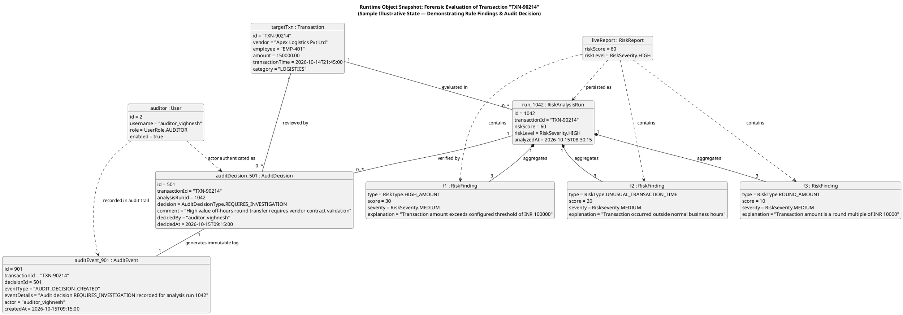

# AUREX — UML Object Diagram Specification

**Document Version:** 1.0  
**Project Name:** AUREX — Financial Audit Risk Platform  
**Academic Context:** BCA Field Project, MIT Arts, Commerce & Science College, Alandi  
**Diagram Source:** [`diagrams/object-diagram.puml`](diagrams/object-diagram.puml)  

---

## 1. Distinction Between Class Diagram & Object Diagram

In the Unified Modeling Language (UML):
- **Class Diagram**: Represents the **static, structural blueprint** of the system. It defines the abstract types, class names, member variables, methods, visibility constraints, inheritance hierarchies, and generalized associations that exist across the entire application lifecycle.
- **Object Diagram**: Represents a **concrete runtime snapshot** of the system at one specific instant in time. It displays concrete object instances (named `instanceName : ClassName`), specific bound attribute values, and instantiated links between those objects.

| Dimension | Class Diagram | Object Diagram |
|---|---|---|
| **Nature** | Static and abstract | Dynamic and concrete |
| **Perspective** | What the system *can* contain | What the system *actually contains* at a specific moment |
| **Attributes** | Field names and data types (e.g. `amount : BigDecimal`) | Concrete bound runtime values (e.g. `amount = 150000.00`) |
| **Multiplicity** | Ranges (e.g., `1` to `0..*`) | Exact instantiated count (e.g., exactly 3 `RiskFinding` instances linked to 1 `RiskAnalysisRun`) |
| **Academic Purpose** | Architectural and relational design defense | Forensic execution verification and runtime state demonstration |

---

## 2. Illustrative Runtime Snapshot

The following PlantUML object diagram illustrates the in-memory object graph during the forensic investigation of a high-risk financial transaction.

> **Disclaimer**: All values shown below are **illustrative sample values** constructed to demonstrate the verified object types and attribute bindings supported by the codebase. They do not represent confidential or production records.

---

## 3. Detailed Walkthrough of the Snapshot Objects

### 3.1 Subject Transaction (`targetTxn : Transaction`)
- **ID:** `"TXN-90214"`
- **Vendor:** `"Apex Logistics Pvt Ltd"`
- **Employee:** `"EMP-401"`
- **Amount:** `150,000.00` INR
- **Transaction Time:** `2026-10-14T21:45:00` (9:45 PM)
- **Category:** `"LOGISTICS"`

### 3.2 Rule Evaluation & Scoring Breakdown (`liveReport` & `run_1042`)
When evaluated against the 6 deterministic rules, this transaction triggers three distinct policy violations:
1. **`f1 : RiskFinding` (High Amount)**:
   - Evaluated by: `HighAmountRule`
   - Condition: Amount of 150,000.00 INR exceeds threshold of 100,000.00 INR.
   - Contribution: **+30 points**
2. **`f2 : RiskFinding` (Unusual Time)**:
   - Evaluated by: `UnusualTimeRule`
   - Condition: Occurred at 21:45:00, outside configured business hours (09:00 to 18:00).
   - Contribution: **+20 points**
3. **`f3 : RiskFinding` (Round Amount)**:
   - Evaluated by: `RoundAmountRule`
   - Condition: Amount of 150,000.00 INR is an exact round multiple of 10,000.00 INR (`remainder == 0`).
   - Contribution: **+10 points**

**Score Aggregation**:
$$\text{Total Score} = \min(30 + 20 + 10, 100) = 60$$
According to `RiskScoreCalculator`, a score of 60 falls directly into the `HIGH` risk band ($60 \le \text{Score} < 80$). This evaluation is persisted as `run_1042` in `risk_analysis_runs`.

### 3.3 Formal Compliance Determination (`auditDecision_501` & `auditEvent_901`)
- The internal auditor (`user1`: `"auditor_vighnesh"`) reviews the transaction in the investigation workspace.
- The auditor records decision `REQUIRES_INVESTIGATION` with investigative notes referencing the off-hours timing and round transfer amount.
- **Actor Integrity**: The backend discards any client-supplied name and populates `decided_by = "auditor_vighnesh"` directly from the active Spring Security `Principal`.
- **Atomic Event Generation**: In the same database transaction, an audit event (`event1`) is recorded with `event_type = "AUDIT_DECISION_CREATED"`, creating an immutable historical record.
