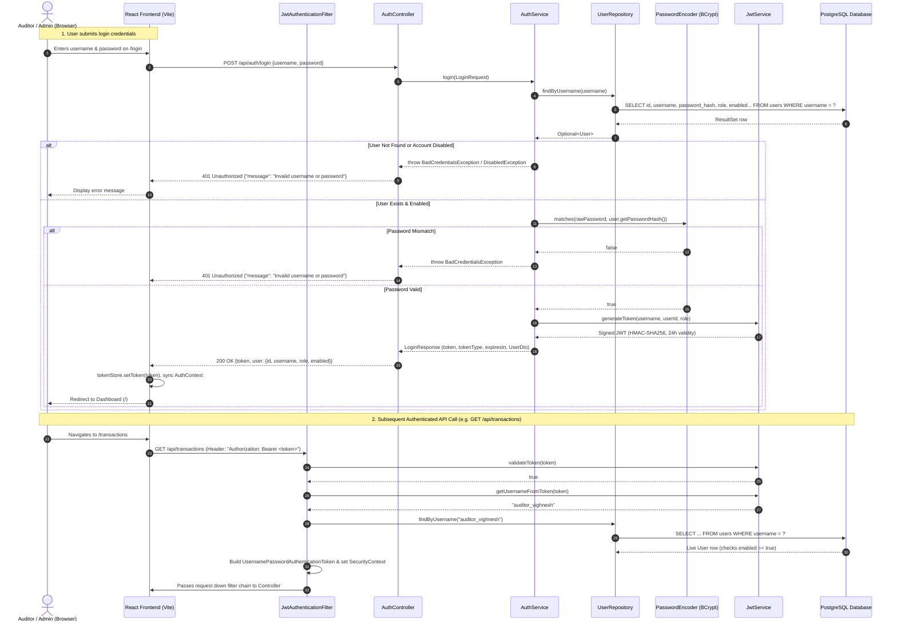
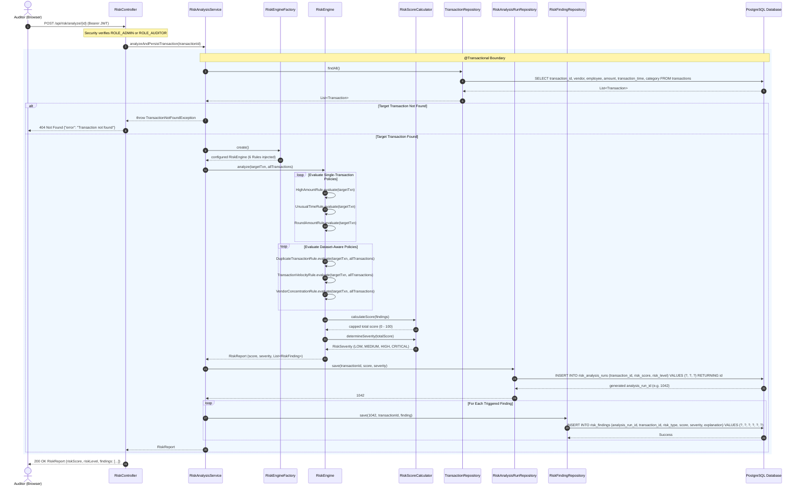
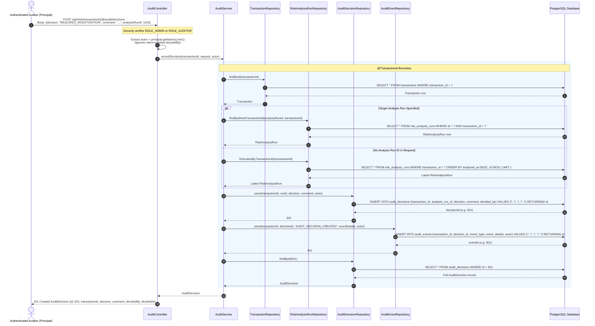
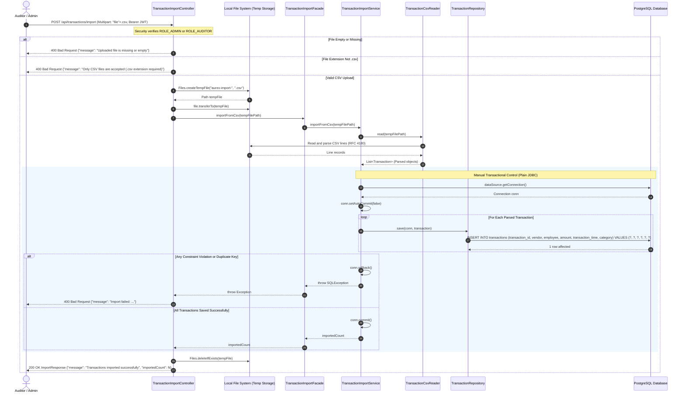
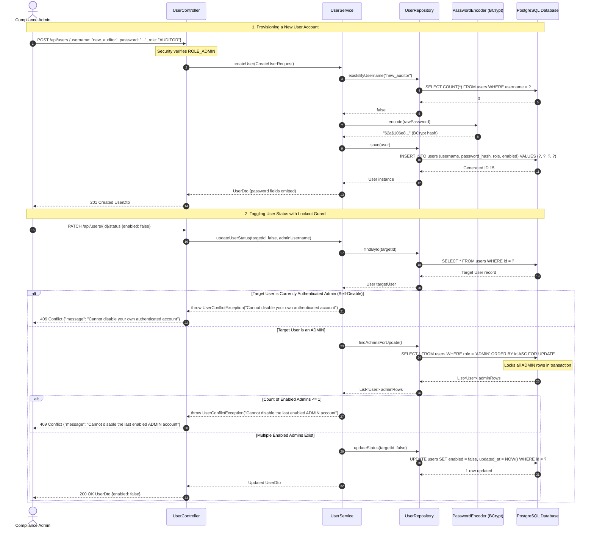

# AUREX — UML Sequence Diagrams Specification

**Document Version:** 1.0  
**Project Name:** AUREX — Financial Audit Risk Platform  
**Academic Context:** BCA Field Project, MIT Arts, Commerce & Science College, Alandi  
**Diagram Sources:**  
- [`diagrams/sequence-login.mmd`](diagrams/sequence-login.mmd)
- [`diagrams/sequence-risk-analysis.mmd`](diagrams/sequence-risk-analysis.mmd)
- [`diagrams/sequence-audit-decision.mmd`](diagrams/sequence-audit-decision.mmd)
- [`diagrams/sequence-csv-import.mmd`](diagrams/sequence-csv-import.mmd)

---

## 1. Sequence Diagram 1: Login & JWT Authentication

Models credential verification, password hash checking, token generation, and subsequent request authentication with live enabled-status validation.

---

## 2. Sequence Diagram 2: Deterministic Risk Analysis & Persistence

Models single-transaction risk evaluation, rule engine invocation across the 6 policies, mathematical score capping, severity categorization, and atomic persistence of the run and findings.

---

## 3. Sequence Diagram 3: Recording an Audit Decision & Audit Event

Models submission of formal auditor determinations, principal identity enforcement, decision persistence, and atomic dual-write (decision + event) within a Spring `@Transactional` boundary. The transaction guarantees atomicity — either both rows are committed or neither is — but does not provide cryptographic immutability or tamper-proof storage.

---

## 4. Sequence Diagram 4: Multipart CSV Ingestion Workflow

Models multipart CSV reception, temporary file disk streaming, RFC 4180 parsing, manual JDBC transactional batch insertion (`connection.setAutoCommit(false)`), rollback handling, and temp-file cleanup.

---

## 5. Sequence Diagram 5: Administrative User Management & Lockout Protection

Models user creation and account status toggling, including the execution of self-disable protection and pessimistic row-locking last-admin lockout prevention.

