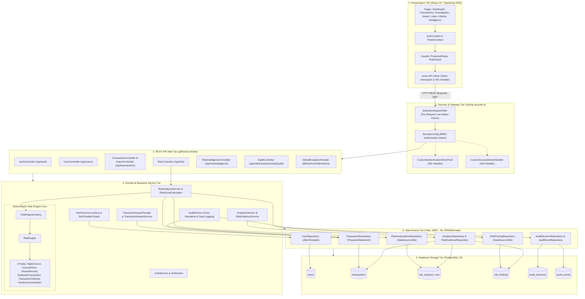
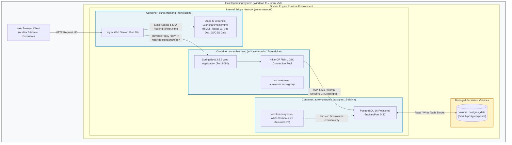

# AUREX — System Architecture Document

**Document Version:** 1.0  
**Project Name:** AUREX — Financial Audit Risk Platform  
**Academic Context:** BCA Field Project, MIT Arts, Commerce & Science College, Alandi  
**Diagram Sources:**  
- [`diagrams/logical-architecture.mmd`](diagrams/logical-architecture.mmd)
- [`diagrams/deployment-architecture.mmd`](diagrams/deployment-architecture.mmd)

---

## 1. Architectural Principles

AUREX is architected as a modern, decoupled web application adhering to the following structural principles:
1. **Decoupled Single Page Application (SPA)**: The user interface is completely decoupled from backend rendering, communicating exclusively over standard REST APIs via JSON.
2. **Stateless Backend**: The Spring Boot application maintains no server-side HTTP session state (`SessionCreationPolicy.STATELESS`), allowing horizontal scalability.
3. **Deterministic Persistence via Plain JDBC**: ORM frameworks (JPA/Hibernate) are intentionally eliminated. All persistence interactions use Spring's `JdbcTemplate`, `DataSourceUtils`, and direct `PreparedStatement` interfaces. This guarantees absolute predictability of executed SQL, prevents hidden N+1 query patterns, and ensures maximum execution speed during bulk CSV imports and analytical aggregations.
4. **Defense in Depth**: Security is enforced at multiple layers: Nginx network gateway, Spring Security HTTP filter chain, `@PreAuthorize` method annotations, and relational database integrity constraints.

---

## 2. Logical Architecture

The logical architecture organizes system components into six cohesive horizontal tiers.

---

## 3. Physical & Runtime Deployment Architecture

The physical deployment is containerized using Docker Compose, dividing the system into three dedicated containers running on an isolated bridge network (`aurex-network`).

---

## 4. Container & Service Specifications

### 4.1 Frontend Container (`aurex-frontend`)
- **Base Image:** `nginx:alpine`
- **Host Port Exposure:** Port `${FRONTEND_PORT:-80}` is **published to the host** (the only container with an externally reachable port). The internal container port is `80`.
- **Nginx Responsibilities:**
  - **Static File Serving**: Serves the compiled production React bundle from `/usr/share/nginx/html`.
  - **Gzip Compression**: Compresses `text/plain`, `text/css`, `application/javascript`, `application/json`, and `image/svg+xml`.
  - **SPA Route Fallback**: `try_files $uri $uri/ /index.html;` ensures client-side routes (e.g. `/transactions/TXN001`) resolve to `index.html`.
  - **Reverse Proxy**: Proxies `/api/` traffic to `http://backend:8080/api/` using internal Docker DNS (not a host-accessible URL). 50MB `client_max_body_size` enforced here to accommodate CSV uploads.
  - **Container Dependencies:** `depends_on: backend (condition: service_healthy)`.

### 4.2 Backend Container (`aurex-backend`)
- **Base Image:** `eclipse-temurin:17-jre-alpine` (multi-stage build from `maven:3.9-eclipse-temurin-17`).
- **Port Exposure:** Port `8080` is internal to the Docker network (`aurex-network`). It is **not published to the host machine** and is only reachable from within the bridge network (e.g., from the Nginx container).
- **Process Security:** Runs as non-root service user `aurexuser` in group `aurexgroup`.
- **Startup Configuration:**
  - Active profile defaults to `prod` (`SPRING_PROFILES_ACTIVE=prod`).
  - `spring.sql.init.mode=never` (schema initialization is handled on container bootstrap).
  - Health check: `wget -q --spider http://127.0.0.1:8080/api/health || exit 1`.
  - Container Dependencies: `depends_on: postgres (condition: service_healthy)`.

### 4.3 Database Container (`aurex-postgres`)
- **Base Image:** `postgres:16-alpine`.
- **Port Exposure:** Port `5432` is restricted to `aurex-network`. It is **not published to the host** by default (the commented-out lines in `docker-compose.yml` could optionally expose `127.0.0.1:5432:5432` for local debugging).
- **Persistence:** Mounts named volume `postgres_data` to `/var/lib/postgresql/data`.
- **Bootstrap Initialization:** Read-only mount of `./src/main/resources/schema.sql` into `/docker-entrypoint-initdb.d/schema.sql`. PostgreSQL executes this script automatically upon fresh volume creation.
- **Health check:** `pg_isready -U postgres -d financial_audit`.

---

## 5. Security Architecture & Boundary Controls

1. **Authentication Boundary**:
   - Clients exchange credentials for a signed JWT at `POST /api/auth/login`.
   - Passwords are encrypted using BCrypt ($2^{10}$ rounds).
   - In production profile (`prod`), `JwtService` asserts that `JWT_SECRET` is at least 32 characters long and does not equal the development default.
2. **Filter Chain Enforcement**:
   - `JwtAuthenticationFilter` intercepts every request before `UsernamePasswordAuthenticationFilter`.
   - It parses the token signature and verifies active account status against PostgreSQL.
   - If user status is `enabled == false`, security context remains unauthenticated, triggering `CustomAuthenticationEntryPoint` (HTTP 401).
3. **CORS Boundary**:
   - Handled in `WebConfig.java` and `SecurityConfig.java`. Allowed origins are injected from `CORS_ALLOWED_ORIGINS` environment variable (defaults to `http://localhost,http://localhost:80,http://localhost:5173,http://localhost:3000`).
4. **Audit Actor Integrity**:
   - The compliance audit trail strictly sources the recorded user from Spring Security's `Principal.getName()`, making it impossible for clients to submit an alternative actor name in the request body. This prevents identity spoofing of audit records. Note: this is an application-level protection, not cryptographic signing or database-level tamper-proofing.

---

## 6. Configuration & Secret Management

All configuration variables are parameterized in `application.properties` and overridable via environment variables:

| Variable Name | Default Value (Dev) | Production Requirement | Purpose |
|---|---|---|---|
| `PORT` | `8080` | `8080` | Spring Boot HTTP port |
| `DB_URL` | `jdbc:postgresql://localhost:5432/financial_audit` | `jdbc:postgresql://postgres:5432/financial_audit` | PostgreSQL JDBC connection string |
| `DB_USERNAME` | `postgres` | Configured secret | Database administrative user |
| `DB_PASSWORD` | `postgres` | **Required in Compose** (`:?` enforced) | Database password |
| `JWT_SECRET` | *(Dev default string)* | **Required in Compose** (min 32 chars) | HMAC-SHA256 signing key |
| `JWT_EXPIRATION` | `86400` (24h) | `86400` | Token expiration time in seconds |
| `AUREX_PROD_INITIAL_ADMIN_PASSWORD` | *(None)* | Optional (min 12 chars) | First-run production admin creation password |
| `AUREX_PROD_INITIAL_ADMIN_USERNAME` | `admin` | `admin` | First-run production admin username |
| `AUREX_SEED_ADMIN_ENABLED` | `false` | Must remain `false` in prod | Blocked automatically if profile is `prod` |
| `CORS_ALLOWED_ORIGINS` | `http://localhost:5173,...` | Set to public domain / host IP | Cross-Origin Resource Sharing whitelist |
| `ENABLE_SWAGGER` | `true` (in dev) | `false` (in prod) | Disables Swagger UI in production |

---

## 7. Assumptions & Production-Readiness Gaps

1. **Schema Migration Tooling**: The system currently initializes via idempotent `schema.sql`. In enterprise production environments with ongoing schema iterations, integrating Flyway or Liquibase is recommended.
2. **TLS / HTTPS Termination**: In the standard Docker Compose setup, Nginx terminates HTTP on port 80. In production internet-facing deployments, a reverse proxy or cloud load balancer (e.g., AWS ALB, Cloudflare, Let's Encrypt Certbot) must be placed in front of Nginx to terminate TLS/HTTPS on port 443.
3. **Database Backup Strategy**: While volume `postgres_data` persists data across container lifecycles, automated backup snapshots (`pg_dump` or WAL-G) must be configured on the host.
