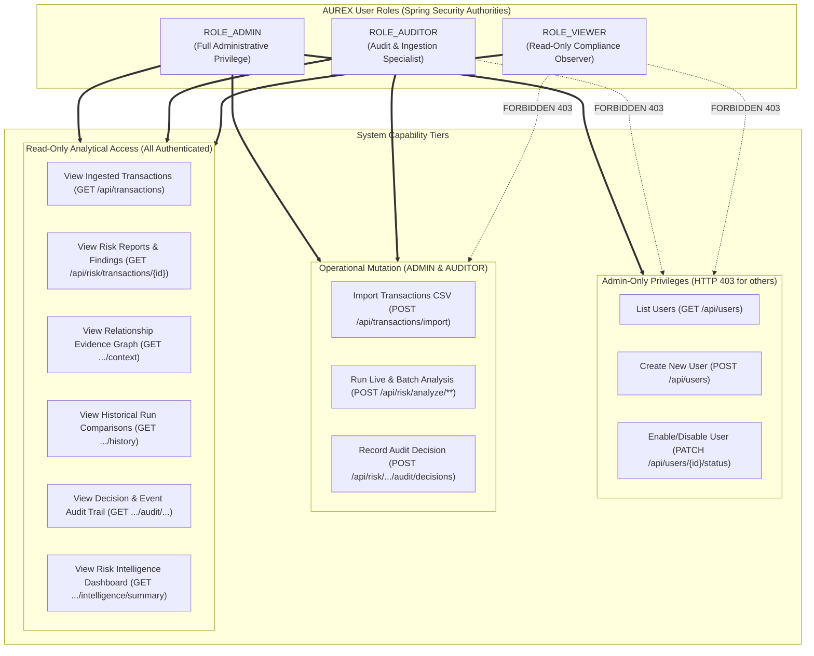

# AUREX — User Roles, Authorization Matrix & User Flows

**Document Version:** 1.0  
**Project Name:** AUREX — Financial Audit Risk Platform  
**Academic Context:** BCA Field Project, MIT Arts, Commerce & Science College, Alandi  
**Diagram Sources:** [`diagrams/user-roles.mmd`](diagrams/user-roles.mmd), [`diagrams/user-journey.mmd`](diagrams/user-journey.mmd)  

---

## 1. Verified User Roles & Authorization Architecture

AUREX implements strict Role-Based Access Control (RBAC) backed by Spring Security 6, JJWT, and a relational `users` table. The application defines three mutually exclusive roles specified in `UserRole.java`:

1. **`ROLE_ADMIN` (Compliance Administrator)**: Full administrative authority over user lifecycle management, administrative status toggling, CSV ingestion, risk analysis execution, and audit decision recording.
2. **`ROLE_AUDITOR` (Internal Auditor)**: Operational investigator authority. Can upload CSV transaction files, execute deterministic risk analysis runs, inspect cross-entity evidence graphs, and submit formal audit decisions. Strictly forbidden from user management.
3. **`ROLE_VIEWER` (Audit Viewer / Executive)**: Read-only compliance observer authority. Can view all ingested transactions, live risk reports, forensic evidence context, historical run comparisons, and executive risk intelligence summaries. Strictly forbidden from modifying any system data.

---

## 2. Role-Permission Matrix (Backend-Enforced vs. UI-Hidden)

> **Critical Security Distinction**: In AUREX, authorization is strictly enforced on the **backend** at the Spring Security filter chain and controller level (`SecurityConfig.java`, `@PreAuthorize`). UI-level guards (React Router's `RoleGuard.tsx` and hidden buttons in `Sidebar.tsx`) exist purely for user convenience; bypassing the frontend UI via direct HTTP requests cannot circumvent backend security.

| Endpoint / Operation | HTTP Method | Public / Anonymous | VIEWER | AUDITOR | ADMIN | Enforcement Mechanism |
|---|---|---|---|---|---|---|
| **System Health Check** (`/api/health`) | `GET` | **ALLOW** | **ALLOW** | **ALLOW** | **ALLOW** | `permitAll()` in `SecurityConfig` |
| **User Login** (`/api/auth/login`) | `POST` | **ALLOW** | **ALLOW** | **ALLOW** | **ALLOW** | `permitAll()` in `SecurityConfig` |
| **OpenAPI / Swagger UI** (`/v3/api-docs`, `/swagger-ui/**`) | `GET` | **ALLOW** | **ALLOW** | **ALLOW** | **ALLOW** | `permitAll()` in `SecurityConfig` |
| **Current User Profile** (`/api/auth/me`) | `GET` | DENY (401) | **ALLOW** | **ALLOW** | **ALLOW** | `anyRequest().authenticated()` |
| **List Ingested Transactions** (`/api/transactions`) | `GET` | DENY (401) | **ALLOW** | **ALLOW** | **ALLOW** | `anyRequest().authenticated()` |
| **Import CSV Transactions** (`/api/transactions/import`) | `POST` | DENY (401) | **DENY (403)** | **ALLOW** | **ALLOW** | `.hasAnyRole("ADMIN", "AUDITOR")` |
| **Live Single-Txn Risk Report** (`/api/risk/transactions/{id}`) | `GET` | DENY (401) | **ALLOW** | **ALLOW** | **ALLOW** | `anyRequest().authenticated()` |
| **Paginated Risk Queue** (`/api/risk/transactions`) | `GET` | DENY (401) | **ALLOW** | **ALLOW** | **ALLOW** | `anyRequest().authenticated()` |
| **Executive Risk Summary** (`/api/risk/summary`) | `GET` | DENY (401) | **ALLOW** | **ALLOW** | **ALLOW** | `anyRequest().authenticated()` |
| **Risk Intelligence Metrics** (`/api/risk/intelligence/summary`) | `GET` | DENY (401) | **ALLOW** | **ALLOW** | **ALLOW** | `anyRequest().authenticated()` |
| **Cross-Entity Evidence Context** (`.../{id}/context`) | `GET` | DENY (401) | **ALLOW** | **ALLOW** | **ALLOW** | `anyRequest().authenticated()` |
| **Historical Evaluation Runs** (`.../{id}/history/**`) | `GET` | DENY (401) | **ALLOW** | **ALLOW** | **ALLOW** | `anyRequest().authenticated()` |
| **Execute Single-Txn Analysis** (`/api/risk/analyze/{id}`) | `POST` | DENY (401) | **DENY (403)** | **ALLOW** | **ALLOW** | `.hasAnyRole("ADMIN", "AUDITOR")` |
| **Execute Batch Risk Analysis** (`/api/risk/analyze-all`) | `POST` | DENY (401) | **DENY (403)** | **ALLOW** | **ALLOW** | `.hasAnyRole("ADMIN", "AUDITOR")` |
| **Record Audit Decision** (`.../{id}/audit/decisions`) | `POST` | DENY (401) | **DENY (403)** | **ALLOW** | **ALLOW** | `.hasAnyRole("ADMIN", "AUDITOR")` |
| **View Audit Decisions & Events** (`.../{id}/audit/**`) | `GET` | DENY (401) | **ALLOW** | **ALLOW** | **ALLOW** | `anyRequest().authenticated()` |
| **List System Users** (`/api/users`) | `GET` | DENY (401) | **DENY (403)** | **DENY (403)** | **ALLOW** | `.hasRole("ADMIN")` & `@PreAuthorize("hasRole('ADMIN')")` |
| **Create New User** (`/api/users`) | `POST` | DENY (401) | **DENY (403)** | **DENY (403)** | **ALLOW** | `.hasRole("ADMIN")` & `@PreAuthorize("hasRole('ADMIN')")` |
| **Toggle User Status** (`/api/users/{id}/status`) | `PATCH` | DENY (401) | **DENY (403)** | **DENY (403)** | **ALLOW** | `.hasRole("ADMIN")` & `@PreAuthorize("hasRole('ADMIN')")` |

---

## 3. User Roles & Permission Boundaries Diagram



---

## 4. End-to-End User Journey

```mermaid
journey
    title Auditor & Admin Journey Through AUREX Financial Audit Platform
    section Authentication & Entry
      Enter credentials on /login: 5: Admin, Auditor, Viewer
      Receive JWT token & restore session: 5: Admin, Auditor, Viewer
      Inspect role-guarded sidebar navigation: 5: Admin, Auditor, Viewer
    section Admin User Administration
      Open /users management view: 5: Admin
      Create new auditor or viewer account: 4: Admin
      Disable compromised account with lockout check: 5: Admin
    section Transaction Data Ingestion
      Navigate to /import workspace: 4: Admin, Auditor
      Select and upload financial transactions CSV: 4: Admin, Auditor
      Validate schema & commit batch atomically: 5: Backend
    section Forensic Risk Analysis
      Trigger batch evaluation (/api/risk/analyze-all): 5: Admin, Auditor
      Review prioritized risk queue on /transactions: 5: Auditor, Viewer
      Open forensic transaction workspace (/transactions/:id): 5: Auditor
      Examine deterministic policy violation findings: 5: Auditor
      Inspect relationship intelligence context (Vendor/Employee/Category): 5: Auditor
    section Audit Decision & Event Logging
      Select audit decision (CONFIRMED_RISK / FALSE_POSITIVE / etc.): 5: Auditor
      Enter investigative findings comment: 4: Auditor
      Submit decision; backend binds authenticated Principal: 5: Backend
      Review immutable audit trail on /history: 5: Auditor, Viewer, Admin
    section Executive Reporting
      Review /intelligence multi-dimensional charts: 5: Viewer, Auditor, Admin
      Analyze vendor & employee concentration anomalies: 5: Viewer, Auditor, Admin
```

---

## 5. Main Operational Workflows

### 5.1 Main Investigation & Audit Decision Workflow
1. **Queue Browsing**: The auditor logs into AUREX and opens the `/transactions` view, where transactions are color-badged by risk severity (`CRITICAL`, `HIGH`, `MEDIUM`, `LOW`).
2. **Forensic Workspace Entry**: The auditor selects a flagged transaction (e.g. `TXN-90214`), opening `/transactions/:id`.
3. **Multi-Policy Inspection**:
   - The workspace presents the composite **Risk Score Gauge** (e.g., 60/100, `HIGH`).
   - The **Policy Findings Breakdown** displays every breached rule with its mathematical score contribution and explanatory text.
4. **Cross-Entity Evidence Graph**:
   - The auditor navigates to the **Evidence Context** tab.
   - The platform queries peer transactions sharing the same vendor, employee, and category, revealing aggregate transaction volumes and historical peak risk scores.
5. **Historical Comparison**:
   - The auditor opens the **History** tab to inspect prior evaluation runs and observe whether the transaction's risk profile has escalated over time.
6. **Submitting Audit Determination**:
   - The auditor opens the **Audit Decision Modal**, selects one of four standardized determinations (`CONFIRMED_RISK`, `FALSE_POSITIVE`, `REQUIRES_INVESTIGATION`, `ESCALATED`), enters investigative commentary, and submits.
   - The backend validates the transaction and run ID, extracts the auditor's identity from Spring Security's `Principal`, and atomically writes to `audit_decisions` and `audit_events`.
   - The decision immediately renders in the transaction workspace.

---

### 5.2 Administrative User Management Workflow
1. **Accessing Directory**: An administrator navigates to `/users`. Non-admin roles see neither the sidebar link nor can they reach the route (blocked by `RoleGuard` on frontend and HTTP 403 on backend).
2. **User Provisioning**:
   - The administrator clicks "Create User", entering `username`, `password` ($\ge 6$ chars), and selects `AUDITOR` or `VIEWER`.
   - On submission, the backend checks `existsByUsername`. If unique, it hashes the password with BCrypt and inserts the user record with `enabled = true`.
3. **Account Disabling & Safety Protections**:
   - To deactivate an account, the admin clicks "Disable" on the target user row, prompting a two-step confirmation state machine.
   - **Self-Disable Guard**: If the administrator attempts to disable their own account (`isSelf == true`), the backend immediately rejects the request with HTTP 409 Conflict (`"Cannot disable your own authenticated account"`).
   - **Last-Admin Lockout Guard**: If the target user is an `ADMIN`, the backend executes `SELECT ... FOR UPDATE` on all admin rows. If active admin count $\le 1$, the operation is rejected with HTTP 409 Conflict (`"Cannot disable the last enabled ADMIN account"`).

---

### 5.3 Authentication Expiry & Immediate Disabled-User Revocation

A critical security feature verified in AUREX is the handling of account revocation:

```
[Auditor with Valid JWT] ─── Request with Bearer Token ───► [JwtAuthenticationFilter]
                                                                     │
                                                              1. Token structurally valid
                                                              2. Signature verified
                                                                     │
                                                                     ▼
                                                          [Query Live DB Status]
                                                          SELECT * FROM users WHERE username = ?
                                                                     │
                                    ┌────────────────────────────────┴────────────────────────────────┐
                                    ▼                                                                 ▼
                              [enabled == true]                                             [enabled == false]
                                    │                                                                 │
                            3. Populate SecurityContext                                       3. Leave Context Empty
                            4. Proceed to Controller                                          4. AuthenticationEntryPoint
                                    │                                                                 │
                                    ▼                                                                 ▼
                                HTTP 200 OK                                                 HTTP 401 Unauthorized
```

- **Token Lifetime**: JWTs have a 24-hour expiration (`jwt.expiration=86400`).
- **Immediate Disablement**: Because `JwtAuthenticationFilter` queries the live user record on every authenticated request, an administrator disabling a compromised account takes effect **immediately on the next HTTP request**. The user does not retain access for the remainder of the 24-hour token validity window.
- **Frontend Session Expiry Recovery**: When the frontend Axios interceptor encounters an HTTP 401, it clears `tokenStore`, sets `sessionExpired = true`, and redirects the user to `/login` with an informative banner: `"Your session has expired. Please log in again."`.
