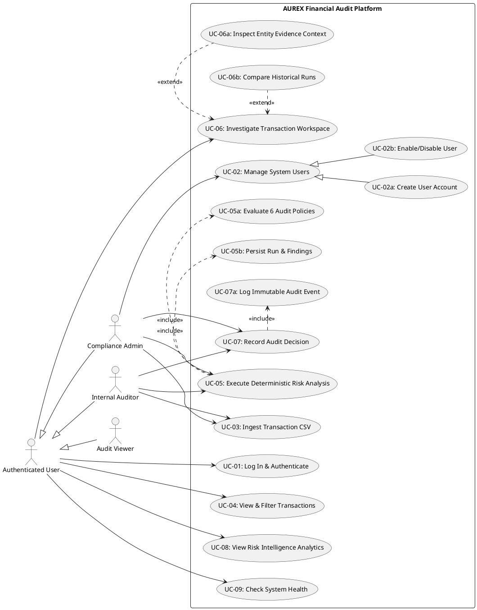

# AUREX — UML Use Case Diagram & Specifications

**Document Version:** 1.0  
**Project Name:** AUREX — Financial Audit Risk Platform  
**Academic Context:** BCA Field Project, MIT Arts, Commerce & Science College, Alandi  
**Diagram Source:** [`diagrams/use-case.puml`](diagrams/use-case.puml)  

---

## 1. UML Use Case Diagram

The use case diagram models the interactions between the system actors (`Compliance Administrator`, `Internal Auditor`, and `Audit Viewer`) and the functional boundaries of the AUREX platform.

---

## 2. Detailed Use Case Specifications

### Use Case UC-01: Log In & Authenticate
- **Primary Actor:** Authenticated User (`ADMIN`, `AUDITOR`, `VIEWER`)
- **Preconditions:** User account exists in PostgreSQL `users` table and `enabled == true`.
- **Main Flow:**
  1. User navigates to `/login` and inputs `username` and `password`.
  2. Frontend sends `POST /api/auth/login`.
  3. Backend queries `UserRepository.findByUsername` and verifies BCrypt hash.
  4. Backend generates signed HMAC-SHA256 JWT and returns `LoginResponse` containing token and `UserDto`.
  5. Frontend stores token in `tokenStore`, updates `AuthContext`, and routes user to `/`.
- **Alternate / Error Flows:**
  - *4a. Invalid Password or Non-existent Username*: Backend returns HTTP 401 Unauthorized with generic message `"Invalid username or password"`.
  - *4b. Account Disabled*: If `user.isEnabled() == false`, backend returns HTTP 401 Unauthorized.
- **Postconditions:** User session is established; JWT token is included in `Authorization: Bearer` header on subsequent API requests.
- **Related Requirements:** `FR-AUTH-01`, `FR-AUTH-02`, `FR-AUTH-03`, `FR-AUTH-04`.

---

### Use Case UC-02a: Create User Account
- **Primary Actor:** Compliance Administrator (`ROLE_ADMIN`)
- **Preconditions:** Administrator is logged in with valid JWT containing `ROLE_ADMIN`.
- **Main Flow:**
  1. Administrator visits `/users` and opens the "Create User" modal.
  2. Administrator inputs username, temporary password ($\ge 6$ chars), and selects role (`AUDITOR` or `VIEWER`).
  3. Frontend sends `POST /api/users`.
  4. Backend verifies caller has `ROLE_ADMIN`.
  5. Backend checks if username already exists (`UserRepository.existsByUsername`).
  6. Backend hashes password using BCrypt, persists user with `enabled = true`, and returns HTTP 201 Created with sanitized `UserDto`.
  7. Frontend displays newly created user in the user table.
- **Alternate / Error Flows:**
  - *5a. Non-Admin Caller*: Backend returns HTTP 403 Forbidden.
  - *5b. Duplicate Username*: Backend returns HTTP 409 Conflict (`"Username '...' already exists"`).
  - *5c. Invalid Payload*: If password is shorter than 6 characters or role is missing, backend returns HTTP 400 Bad Request.
- **Postconditions:** New user record exists in `users` table and is eligible for login.
- **Related Requirements:** `FR-USER-01`, `FR-USER-02`.

---

### Use Case UC-02b: Enable / Disable User Account
- **Primary Actor:** Compliance Administrator (`ROLE_ADMIN`)
- **Preconditions:** Administrator is logged in with valid JWT; target user account exists.
- **Main Flow:**
  1. Administrator clicks "Disable" on a user row in `/users`.
  2. Frontend enters confirmation state machine, asking the admin to confirm.
  3. Administrator clicks "Confirm Disable".
  4. Frontend sends `PATCH /api/users/{id}/status` with body `{"enabled": false}`.
  5. Backend verifies target is not the admin's own authenticated account.
  6. If target is an `ADMIN`, backend locks admin rows using `SELECT ... FOR UPDATE` and verifies at least one other active admin remains.
  7. Backend updates `users.enabled = false` and returns HTTP 200 OK.
  8. Frontend updates row status badge to "Disabled".
- **Alternate / Error Flows:**
  - *5a. Self-Disable Attempt*: Backend returns HTTP 409 Conflict (`"Cannot disable your own authenticated account"`).
  - *6a. Last Admin Lockout Attempt*: Backend returns HTTP 409 Conflict (`"Cannot disable the last enabled ADMIN account"`).
- **Postconditions:** Target account is disabled; subsequent API calls using target's tokens receive HTTP 401 Unauthorized immediately.
- **Related Requirements:** `FR-AUTH-04`, `FR-USER-03`, `FR-USER-04`, `FR-USER-05`.

---

### Use Case UC-03: Ingest Transaction CSV
- **Primary Actor:** Internal Auditor (`ROLE_AUDITOR`) or Compliance Admin (`ROLE_ADMIN`)
- **Preconditions:** User is authenticated with `ROLE_ADMIN` or `ROLE_AUDITOR`.
- **Main Flow:**
  1. User navigates to `/import`, selects a `.csv` file, and clicks "Upload & Ingest".
  2. Frontend sends multipart `POST /api/transactions/import`.
  3. Backend streams file to temporary storage, validates extension and content.
  4. `TransactionCsvReader` parses transaction lines (RFC 4180).
  5. `TransactionImportService` opens connection, disables auto-commit (`conn.setAutoCommit(false)`), and executes batch inserts into `transactions`.
  6. Connection commits; temporary file is deleted.
  7. Backend returns HTTP 200 OK `ImportResponse` with imported row count.
- **Alternate / Error Flows:**
  - *3a. File Missing or Empty*: Backend returns HTTP 400 Bad Request (`"Uploaded file is missing or empty"`).
  - *3b. Non-CSV Extension*: Backend returns HTTP 400 Bad Request (`"Only CSV files are accepted"`).
  - *5a. Database Constraint Failure*: Transaction rolls back via `conn.rollback()`; backend returns HTTP 400 Bad Request with root cause.
- **Postconditions:** Financial records are durably committed to the `transactions` table.
- **Related Requirements:** `FR-INGEST-01`, `FR-INGEST-02`, `FR-INGEST-03`, `FR-INGEST-04`.

---

### Use Case UC-05: Execute Deterministic Risk Analysis
- **Primary Actor:** Internal Auditor (`ROLE_AUDITOR`) or Compliance Admin (`ROLE_ADMIN`)
- **Preconditions:** Transactions exist in `transactions` table.
- **Main Flow:**
  1. User triggers batch evaluation (`POST /api/risk/analyze-all`) or single transaction evaluation (`POST /api/risk/analyze/{id}`).
  2. Backend loads transactions from `TransactionRepository`.
  3. `RiskEngineFactory` constructs `RiskEngine` configured with all 6 policy rules.
  4. `RiskEngine` evaluates rules against transaction(s) (`<<include>>` UC-05a).
  5. `RiskScoreCalculator` sums triggered scores, caps at 100, and categorizes severity tier.
  6. Backend persists run record to `risk_analysis_runs` and individual findings to `risk_findings` (`<<include>>` UC-05b) in a `@Transactional` block.
  7. Backend returns evaluation summary or `RiskReport`.
- **Alternate / Error Flows:**
  - *2a. Transaction Not Found*: Single-transaction analysis returns HTTP 404 Not Found.
  - *1a. Viewer Attempts Execution*: Backend returns HTTP 403 Forbidden.
- **Postconditions:** Evaluation run and findings are persisted in database; risk score is updated in analytical queries.
- **Related Requirements:** `FR-RISK-01` through `FR-RISK-10`.

---

### Use Case UC-06: Investigate Transaction Workspace
- **Primary Actor:** Authenticated User (`ADMIN`, `AUDITOR`, `VIEWER`)
- **Preconditions:** Target transaction exists in `transactions` table.
- **Main Flow:**
  1. User navigates to `/transactions/:id`.
  2. Frontend queries `GET /api/risk/transactions/{id}` to fetch live risk score and policy findings.
  3. Frontend renders the score gauge (0–100), severity badge, and findings cards.
  4. User can inspect peer evidence context graph (`<<extend>>` UC-06a) via `GET .../context`.
  5. User can inspect historical evaluation runs (`<<extend>>` UC-06b) via `GET .../history`.
- **Postconditions:** Auditor has full forensic context to make an informed compliance determination.
- **Related Requirements:** `FR-RISK-09`, `FR-AUDIT-01`, `FR-AUDIT-02`.

---

### Use Case UC-07: Record Audit Decision
- **Primary Actor:** Internal Auditor (`ROLE_AUDITOR`) or Compliance Admin (`ROLE_ADMIN`)
- **Preconditions:** Target transaction exists and at least one risk analysis run has been recorded.
- **Main Flow:**
  1. In the investigation workspace, the auditor opens the decision modal.
  2. Auditor selects decision (`CONFIRMED_RISK`, `FALSE_POSITIVE`, `REQUIRES_INVESTIGATION`, `ESCALATED`) and enters qualitative notes.
  3. Frontend sends `POST /api/risk/transactions/{id}/audit/decisions`.
  4. `AuditController` extracts actor identity from authenticated `Principal`.
  5. `AuditService` verifies transaction and analysis run existence.
  6. Backend writes decision row to `audit_decisions`.
  7. Backend writes immutable event log to `audit_events` (`<<include>>` UC-07a) within the same database transaction.
  8. Backend returns HTTP 201 Created with saved `AuditDecision`.
- **Alternate / Error Flows:**
  - *3a. Viewer Role Attempts Decision*: Backend returns HTTP 403 Forbidden.
  - *5a. No Analysis Run Exists*: Backend returns HTTP 404 Not Found.
  - *2a. Missing Decision Type*: Backend returns HTTP 400 Bad Request.
- **Postconditions:** Formal decision is recorded; transaction undergoes audit status transition; event log is immutable.
- **Related Requirements:** `FR-AUDIT-03`, `FR-AUDIT-04`, `FR-AUDIT-05`, `FR-AUDIT-06`.
